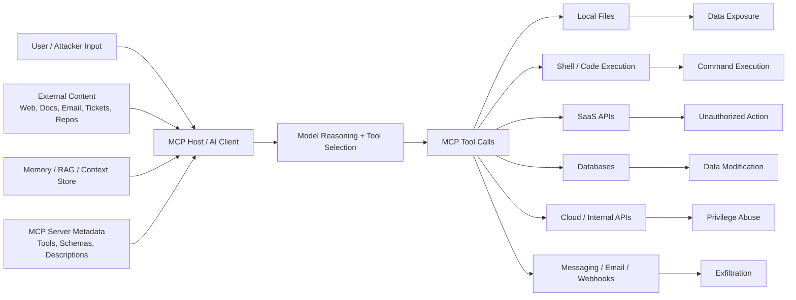

# 3.1 Information Gathering (`INFO`)

[← Chapter 3 overview](<3. MCP Threats and Attack Patterns.md>) · [Test case format](test-case-format.md)

## Overview

Information gathering establishes the **attack surface** of an MCP deployment before any exploit attempts. Unlike a single web app with one API surface, MCP systems span hosts, locally spawned servers, remote transports, dynamic tool lists, and model-visible metadata.

## Why this category matters

Without inventory you will miss shadow MCP servers, over-privileged tools, or sensitive resources that never appear in architecture diagrams. INFO tests produce the data model for threat modeling in [Chapter 3](../03-mcp-security-testing-framework.md).

## Scope

Hosts and clients (installed servers, config paths), server capabilities (tools/resources/prompts), trust boundaries (stdio vs remote HTTP, gateway placement), and data flows (what context reaches the model).

## When to prioritize

Run **first** on every assessment. Re-run after server updates or registry changes.

## Related categories

[AUTHZ](3.04-authorization-permission.md), [RSRC](3.06-resource-data-access.md), [GOV](3.14-enterprise-governance.md), [SUPP](3.13-supply-chain.md)

## Common test chains

INFO-04 (trust boundaries) → AUTHZ-05 (workspace escape); INFO-05 (context flows) → PRMT-02 (indirect injection).

## Threats and attack patterns

These are published cases that change what an inventory must include. Quotations are short extracts from the linked source. Version ranges and dates are those stated by that source. Confirm them again at test time, because packages are patched and advisories are revised.

### Client configuration is a credential and server inventory

Invariant Labs (1 April 2025) reported that a malicious MCP tool description could cause Cursor’s agent to read `~/.cursor/mcp.json` and SSH keys, then pass that content back in a tool argument the confirmation dialog did not fully show. They wrote that the configuration file “is typically used to store credentials for other MCP servers, or entire workflow platforms, like in the case of Zapier's MCP integration.”

> “A Tool Poisoning Attack occurs when malicious instructions are embedded within MCP tool descriptions that are invisible to users but visible to AI models.”
>
> — Invariant Labs, [MCP Security Notification: Tool Poisoning Attacks](https://invariantlabs.ai/blog/mcp-security-notification-tool-poisoning-attacks) (1 April 2025)

**What to record in INFO:** every host config path, every server command and URL, and which of those files can contain tokens. A tool list taken only from the UI is incomplete, because the model receives the full description. Related tests: `MCPSTG-INFO-01`, `MCPSTG-INFO-02`, `MCPSTG-INFO-05`. The tool-description pattern itself is tested in [3.5](3.05-tool-security.md).

### Startup commands in client config are code execution

The MCP project’s security best-practices document (spec docs dated 28 July 2026) treats a local server as a downloaded program that runs with the client’s privileges. One listed condition is an attacker-supplied startup command in the client configuration. The same document says local servers “may have direct access to the user’s system and may be accessible to other processes running on the user’s machine.”

> “If an MCP client supports one-click local MCP server configuration, it MUST implement proper consent mechanisms prior to executing commands.”
>
> — [Security Best Practices](https://modelcontextprotocol.io/docs/2026-07-28/tutorials/security/security_best_practices), Model Context Protocol (28 July 2026 docs)

**What to record in INFO:** the exact command line, arguments, package name, and version for every local server, and whether the host displayed that command before running it. Related tests: `MCPSTG-INFO-01`, `MCPSTG-INFO-04`. Deployment checks are in [3.2](3.02-configuration-deployment.md) and package provenance in [3.13](3.13-supply-chain.md).

### Network-bound servers are missing from a stdio-only inventory

Two GitHub-reviewed advisories describe MCP servers whose documented HTTP or SSE mode listened on all interfaces and did not require authentication:

- `excel-mcp-server` through 0.1.7 ([CVE-2026-40576](https://github.com/advisories/GHSA-j98m-w3xp-9f56), GitHub Advisory Database). The advisory says the documented remote mode uses SSE or Streamable HTTP, the default bind address is `0.0.0.0`, and the server adds no authentication. The same advisory describes a path-traversal flaw in `get_excel_path()`.
- `mcp-atlassian` before 0.17.0. [CVE-2026-27825](https://github.com/advisories/GHSA-xjgw-4wvw-rgm4) (Critical, published 24 February 2026) and [CVE-2026-27826](https://github.com/advisories/GHSA-7r34-79r5-rcc9) (High, same date) both state that the HTTP transports did not require authentication. Pluto Security’s write-up of those CVEs says the HTTP transport defaulted to binding on `0.0.0.0` ([MCPwnfluence](https://pluto.security/blog/mcpwnfluence-cve-2026-27825-critical/)).

**What to record in INFO:** listen address, port, transport (`stdio`, SSE, Streamable HTTP), and whether a caller on another host can open a session. An inventory that only reads desktop config files will miss a server a colleague started with `streamable-http`. Related tests: `MCPSTG-INFO-01`, `MCPSTG-INFO-04`.

### Installed packages outlive the registry listing

Snyk reported that the npm package `postmark-mcp` was removed from the registry on 25 September 2025 after versions from about `1.0.16` added a hidden BCC on outbound mail. Snyk’s impact note is an inventory problem as much as a mail problem:

> “Even if the package is later removed from npm, installed copies keep running until explicitly uninstalled, and configurations are updated.”
>
> — Snyk, [Malicious MCP Server on npm postmark-mcp Harvests Emails](https://snyk.io/blog/malicious-mcp-server-on-npm-postmark-mcp-harvests-emails/) (25 September 2025)

**What to record in INFO:** package name, version, install path, and the host config entry that still launches it. Registry absence is not evidence the binary is gone. Related test: `MCPSTG-INFO-01`, then [3.13](3.13-supply-chain.md).

### Attack surface and pattern catalog

The rest of this section is the attack-surface model for the whole test catalog. Pattern names in the summary link to the section that carries the full write-up and the tests.


This section documents common MCP-specific and MCP-enabled attack techniques. MCP changes the attack surface because the model is no longer just answering questions; it is connected to tools, files, APIs, databases, terminals, tickets, repositories, calendars, browsers, and enterprise workflows.

In a traditional application, attacker-controlled input may reach code paths, queries, templates, or APIs. In an MCP-enabled system, attacker-controlled input may also reach the model’s reasoning context, tool-selection logic, tool schemas, tool outputs, memory, retrieval results, authorization flows, and local execution environment.

The simple mental model:

```text
Classic AppSec:    User input  -> Application logic -> Database/API
MCP AppSec:        User input  -> Model context     -> Tool selection -> External action
                                     ^                    |
                                     |                    v
                              Tool metadata       Files / APIs / shell / SaaS / internal systems
```

MCP security failures often happen at the seams:

* Between trusted instructions and untrusted content.
* Between tool descriptions and actual tool behavior.
* Between the tool list a person approved and the tool list the server returns later.
* Between one MCP server and another MCP server.
* Between user consent and delegated authorization.
* Between a token’s real audience and the API that ends up accepting it.
* Between local developer convenience and production-grade control.
* Between a process bound to localhost and every browser tab on that machine.
* Between “the model suggested it” and “the system executed it.”

A good MCP threat model should ask:

1. **What can enter the model context?** Prompts, files, webpages, tickets, tool outputs, memory, RAG results, schemas, logs, emails, repositories, PDFs.
2. **What can the model call?** Local tools, SaaS APIs, shell commands, code execution, databases, cloud APIs, messaging platforms.
3. **What privileges do those tools carry?** User tokens, service tokens, cloud roles, filesystem access, repository permissions, admin APIs.
4. **What crosses trust boundaries?** External content entering internal context, low-trust tools influencing high-trust tools, local servers accessing enterprise data.
5. **What is logged, reviewed, and reversible?** Tool calls, arguments, outputs, approvals, data movement, permission grants, server changes.

| Boundary | Why it matters | Example failure |
| --- | --- | --- |
| User ↔ host | User intent has to be confirmed before a risky action. | The user asked for a summary. The agent modified files or sent data out. |
| Host ↔ model | The model is not a policy engine. | Prompt injection convinces the model to request a sensitive tool call. |
| Client ↔ MCP server | The client has to know which server is installed and what changed. | A local server update adds `read_secrets` or `run_command`. |
| Workspace ↔ agent context | Files, READMEs, issues, webpages, and logs may contain attacker-controlled instructions. | A repository README tells the agent to exfiltrate `.env`. |
| Tool output ↔ model | Tool output becomes the next prompt. | A fetched page contains hidden instructions to call another tool. |

When inventorying a host, record the security-relevant fields, not only a product name:

* Type: IDE extension, desktop app, CLI, browser app, or enterprise platform.
* MCP support: local, remote, stdio, HTTP.
* Permission model, workspace trust, and whether tool lists, schemas, and changes are shown.
* Logging: local history, exportable logs, or SIEM.
* High-risk tools: shell, filesystem, Git, browser, database, cloud, email.
* Local launch: full command shown, sandbox, whether the user environment is inherited.
* Sampling and elicitation: shown before use, auto-approved, or not supported.
* Remote auth: PKCE, token storage, metadata-fetch protections.
* Config locations: user file, workspace file, imports from other hosts.
* Security documentation and known advisories.

Config paths for current desktop hosts are in [3.2](3.02-configuration-deployment.md#where-host-configs-live). Approval prompts are in [3.4](3.04-authorization-permission.md#tool-permission-ux).

### High-Level MCP Attack Surface




### Threat Pattern Summary

| Pattern                               | Core Abuse                                      | Primary Target                       | Common Impact                              |
| ------------------------------------- | ----------------------------------------------- | ------------------------------------ | ------------------------------------------ |
| [Tool Poisoning](3.05-tool-security.md#tool-poisoning)     | Malicious tool metadata influences the model    | Tool descriptions and metadata       | Unsafe tool selection, hidden instructions |
| [Full-Schema Poisoning](3.05-tool-security.md#full-schema-poisoning) | Malicious instructions hidden inside schemas | Parameters, examples, nested fields | Stealthy prompt injection through schemas  |
| [Prompt Injection](3.07-prompt-instruction.md#prompt-injection) | Attacker text manipulates model behavior        | User/model instruction hierarchy     | Tool abuse, data leakage, policy bypass    |
| [Indirect Prompt Injection](3.07-prompt-instruction.md#indirect-prompt-injection) | External content carries malicious instructions | Webpages, docs, tickets, repos, PDFs | Cross-content compromise            |
| [Context Poisoning](3.08-context-memory.md#context-poisoning) | Bad data persists in model context            | Memory, RAG, tool outputs, files     | Long-lived manipulation                    |
| [Tool Shadowing](3.05-tool-security.md#tool-shadowing)     | Unsafe tool imitates a safe tool                | Tool names/descriptions              | Wrong-tool execution                       |
| [Cross-Server Tool Confusion](3.05-tool-security.md#cross-server-tool-confusion) | Tools from different servers are confused | Multi-server environments       | Boundary collapse                          |
| [Confused Deputy Issues](3.03-identity-authentication.md#confused-deputy-issues) | System acts with privileges attacker lacks | OAuth/API delegation              | Unauthorized access/action                 |
| [Token and Secret Leakage](3.17-secrets-credentials.md#token-and-secret-leakage) | Credentials leak through context/tools/logs | Secrets, env vars, tokens       | Account takeover, lateral movement         |
| [Excessive Tool Permissions](3.04-authorization-permission.md#excessive-tool-permissions) | Tools have broader access than needed    | File/API/shell scopes                | Larger blast radius                        |
| [Dangerous Command Execution](3.05-tool-security.md#dangerous-command-execution) | Untrusted input reaches execution layer | Shell/code tools                  | RCE, file tampering, data loss             |
| [Data Exfiltration Through Tool Chains](3.09-agentic-workflow.md#data-exfiltration-through-tool-chains) | Tools are chained to move sensitive data | Read + summarize + send tools | Quiet data theft                    |
| [Shadow MCP Servers](3.14-enterprise-governance.md#shadow-mcp-servers) | Unmanaged servers run locally or internally | Developer endpoints                  | Hidden access paths                        |
| [MCP Supply Chain Attacks](3.13-supply-chain.md#mcp-supply-chain-attacks) | Malicious packages or updates enter MCP stack | Packages, registries, dependencies | Compromise at install/update time     |
| [Rug Pulls and Tool-Definition Drift](3.05-tool-security.md#rug-pulls-and-tool-definition-drift) | Approved metadata or launch command changes later | `tools/list`, install config | Silent behavior change after review |
| [Poisoned Tool Results](3.11-output-handling.md#poisoned-tool-results) | A tool response carries the next instruction | Tool outputs                       | Second-order tool abuse                    |
| [Resource and Prompt Poisoning](3.06-resource-data-access.md#resource-and-prompt-poisoning) | Hostile text arrives as reference data | Resources, prompt templates     | Context hijack outside the tool schema     |
| [Authorization-Flow Abuse](3.03-identity-authentication.md#authorization-flow-abuse) | Consent, audience, or redirect checks fail | OAuth proxy and token handling | Stolen codes, cross-service token use     |
| [Server-Side Request Forgery](3.16-gateway-egress.md#server-side-request-forgery) | Client or tool fetches an attacker-chosen URL | OAuth metadata, URL parameters | Internal network and cloud metadata access |
| [Session and State-Handle Hijacking](3.03-identity-authentication.md#session-and-state-handle-hijacking) | A guessed handle stands in for identity | Session IDs, workflow handles | Cross-user reads and actions             |
| [Localhost Exposure and DNS Rebinding](3.15-transport-channel.md#localhost-exposure-and-dns-rebinding) | A web page reaches an open local MCP listener | Unauthenticated HTTP on loopback | Tool calls from the browser       |
| [Hostile Server URLs and Install Commands](3.15-transport-channel.md#hostile-server-urls-and-install-commands) | A remote endpoint drives client-side execution | Auth URLs, one-click install commands | Host compromise on connect |
| [Scope Creep](3.04-authorization-permission.md#scope-creep)           | Broad scopes are granted before they are needed | OAuth scopes                         | Stolen token with a wide blast radius      |
| [Sampling Abuse](3.08-context-memory.md#sampling-abuse)     | A server asks the user’s model to complete work | `sampling/createMessage`            | Context leaked back to the server          |


### Documented Public Samples

The patterns above are the vocabulary. This section is the public record those words come from: researcher demonstrations, vendor responses, and one package that was malicious in a registry. Quotes are short and linked. The write-ups describe what was shown and what broke. They do not reproduce the payloads.

Treat three labels as different:

* **Demonstration.** Researchers ran it on their own accounts or a lab tenant. No vendor customer breach is claimed.
* **In-the-wild package.** The code was published where developers install from, and people downloaded it.
* **Failed payload.** The malicious code shipped, and the vendor says it did not run.

Secondary summaries sometimes collapse those into “an attacker stole production data.” Where a vendor has contradicted that, the vendor statement is the one to keep.

### Sample catalog

| When | What | Label | Patterns in this chapter | Primary source |
| --- | --- | --- | --- | --- |
| 1 Apr 2025 | Hidden instructions in a tool description; a second server rewrites a trusted tool | Demonstration | Tool poisoning, schema poisoning, shadowing, secret leakage | [Invariant Labs](https://invariantlabs.ai/blog/mcp-security-notification-tool-poisoning-attacks) |
| 7 Apr 2025 | Sleeper server, then a WhatsApp message alone, steers a trusted chat server | Demonstration | Rug pull, shadowing, poisoned tool results | [Invariant Labs](https://invariantlabs.ai/blog/whatsapp-mcp-exploited) |
| 26 May 2025 | A public GitHub issue drives a private-repo read and a public pull request | Demonstration | Indirect injection, tool-chain exfiltration, excessive permissions | [Invariant Labs](https://invariantlabs.ai/blog/mcp-github-vulnerability) |
| 16 Jun 2025 | Lethal trifecta named as the condition, with GitHub MCP as the example | Analysis | Cross-cutting | [Simon Willison](https://simonwillison.net/2025/jun/16/the-lethal-trifecta/) |
| Jun 2025 | Jira Service Management ticket uses the support engineer as a proxy | Demonstration | Indirect injection, confused deputy, tool-chain exfiltration | [Cato Networks](https://www.catonetworks.com/blog/cato-ctrl-poc-attack-targeting-atlassians-mcp/) |
| Jul 2025 | Support-ticket text plus a `service_role` SQL tool writes secrets back into the ticket | Demonstration | Indirect injection, excessive permissions, poisoned tool results | [General Analysis](https://generalanalysis.com/blog/supabase-mcp-blog) |
| Jul 2025 | `mcp-remote` 0.0.5–0.1.15 runs a server-supplied authorization URL as a command | Vulnerability | Hostile server URLs | [JFrog](https://jfrog.com/blog/2025-6514-critical-mcp-remote-rce-vulnerability/) |
| 17 Jul 2025 | Amazon Q Developer for VS Code 1.84.0 ships a destructive prompt; AWS says it did not execute | Failed payload | Supply chain, dangerous command execution | [AWS](https://aws.amazon.com/security/security-bulletins/AWS-2025-015/) |
| 15–17 Sep 2025 | npm `postmark-mcp` 1.0.16 copies every sent email to an outside mailbox | In the wild | Supply chain, rug-pull-shaped update, secret leakage | [Koi](https://www.koi.ai/blog/postmark-mcp-npm-malicious-backdoor-email-theft) |
| Feb 2026, as reported Jul 2026 | Trojanized Oura Ring MCP server submitted to a registry | Secondary report | Shadow MCP, supply chain | [UpGuard](https://www.upguard.com/blog/mcp-security-incidents), citing Straiker |

Adjacent, and not an MCP server: in February 2025 Legit Security showed GitLab Duo reading a private merge request because hidden text in a public project told it to, then leaking that code through an image URL the chat UI rendered. GitLab patched the HTML path. Willison files it with the same trifecta. ([Legit Security](https://www.legitsecurity.com/blog/remote-prompt-injection-in-gitlab-duo))


### What the samples have in common

UpGuard’s table of the cases they reviewed is a fair summary of the public set, with the Amazon Q row corrected as above. Across the demonstrations and the `postmark-mcp` package:

* The agent treated tool descriptions, issues, tickets, or tool results as instructions.
* The action happened during ordinary use: summarize issues, list tickets, send mail, connect a server.
* Endpoint and network tools that watch for exploits did not see a payload. They saw an assistant doing the job it was given, or a package doing the job plus one extra copy.
* The developer workstation, and the token on it, was the target. Production was reached through that token, when it was reached at all.

The control that shows up in every vendor response is the same short list. Scope the token to one project or one repository. Prefer read-only until a write is required. Show the full tool name, server, arguments, and definition hash before the call. Diff `tools/list` and package versions against the hash you approved. Do not let text from a ticket, an issue, or another server decide a second tool call.


### Section Takeaway

MCP security is about more than a bug in a tool handler. A lot of the damage happens when a legitimate tool is aimed at the wrong thing, or when a decision that felt safe at install time is still trusted after the server changed its mind. The public record for that claim is in [Documented Public Samples](#documented-public-samples): most of those cases are demonstrations on the researcher’s own tenant, one package on npm was malicious in the wild, and the Amazon Q payload shipped but did not run.

```text
Never treat model intent as authorization.
Never treat tool metadata as a trusted instruction.
Never treat yesterday's approval as today's tool.
Never treat external content, tool results, or resources as safe context.
Never give a tool, or a token, more power than the workflow requires.
Never treat localhost as a closed room.
```

MCP gives AI hands. Security has to decide what those hands are allowed to touch, and it has to notice when the hands change.


### References

The write-ups above are paraphrased from public guidance and advisories. Version floors go stale. Re-read the advisory before you ship a minimum version.

1. [MCP Security Notification: Tool Poisoning Attacks — Invariant Labs](https://invariantlabs.ai/blog/mcp-security-notification-tool-poisoning-attacks)
2. [MCP Tool Poisoning: Adversarial Hijacking of AI Agent Workflows — Cloud Security Alliance](https://labs.cloudsecurityalliance.org/wp-content/uploads/2026/07/CSA_research_note_mcp_tool_poisoning_ai_agent_exfiltration_20260702-csa-styled.pdf)
3. [CVE-2025-54136 — NIST NVD](https://nvd.nist.gov/vuln/detail/CVE-2025-54136)
4. [MCP Security Cheat Sheet — OWASP Cheat Sheet Series](https://cheatsheetseries.owasp.org/cheatsheets/MCP_Security_Cheat_Sheet.html)
5. [Beyond the Protocol: Unveiling Attack Vectors in the Model Context Protocol (MCP) Ecosystem — Song et al., arXiv:2506.02040](https://arxiv.org/abs/2506.02040)
6. [Security Best Practices, revision 2026-07-28 — Model Context Protocol](https://modelcontextprotocol.io/docs/2026-07-28/tutorials/security/security_best_practices)
7. [Authorization Security Considerations — Model Context Protocol](https://modelcontextprotocol.io/specification/2026-07-28/basic/authorization/security-considerations)
8. [RFC 8707: Resource Indicators for OAuth 2.0](https://www.rfc-editor.org/rfc/rfc8707)
9. [Security Considerations for Model Context Protocol (MCP) Implementations — IETF Internet-Draft](https://www.ietf.org/archive/id/draft-mohiuddin-mcp-security-considerations-00.html)
10. [CVE-2025-66414, TypeScript SDK DNS rebinding — GitHub Advisory Database](https://github.com/advisories/GHSA-w48q-cv73-mx4w)
11. [CVE-2025-66416, Python SDK DNS rebinding — GitHub Advisory Database](https://github.com/advisories/GHSA-9h52-p55h-vw2f)
12. [CVE-2025-6514: critical mcp-remote vulnerability — JFrog](https://jfrog.com/blog/2025-6514-critical-mcp-remote-rce-vulnerability/)
13. [CVE-2025-6514, mcp-remote command injection — GitHub Advisory Database](https://github.com/advisories/GHSA-6xpm-ggf7-wc3p)
14. [OWASP MCP Top 10 — OWASP Foundation](https://owasp.org/www-project-mcp-top-10/)
15. [CVE-2026-34742, Go SDK DNS rebinding — NIST NVD](https://nvd.nist.gov/vuln/detail/CVE-2026-34742)
16. [CVE-2026-35568, Java SDK DNS rebinding — NIST NVD](https://nvd.nist.gov/vuln/detail/CVE-2026-35568)
17. [Sampling — Model Context Protocol specification](https://modelcontextprotocol.io/specification/2025-11-25/client/sampling)
18. [RFC 9207: OAuth 2.0 Authorization Server Issuer Identification](https://www.rfc-editor.org/rfc/rfc9207)
19. [WhatsApp MCP Exploited — Invariant Labs, 7 April 2025](https://invariantlabs.ai/blog/whatsapp-mcp-exploited)
20. [GitHub MCP Exploited: Accessing private repositories via MCP — Invariant Labs, 26 May 2025](https://invariantlabs.ai/blog/mcp-github-vulnerability)
21. [Exfiltrate information from private repositories — github/github-mcp-server#844](https://github.com/github/github-mcp-server/issues/844)
22. [The lethal trifecta for AI agents — Simon Willison, 16 June 2025](https://simonwillison.net/2025/jun/16/the-lethal-trifecta/)
23. [Supabase MCP can leak your entire SQL database — Simon Willison, 6 July 2025](https://simonwillison.net/2025/jul/6/supabase-mcp-lethal-trifecta/)
24. [Supabase MCP Security: How Prompt Injection Leaked Private Tables — General Analysis](https://generalanalysis.com/blog/supabase-mcp-blog)
25. [Defense in Depth for MCP Servers — Supabase](https://supabase.com/blog/defense-in-depth-mcp)
26. [PoC Attack Targeting Atlassian’s MCP — Cato CTRL](https://www.catonetworks.com/blog/cato-ctrl-poc-attack-targeting-atlassians-mcp/)
27. [MCP Clients: Understanding the potential security risks — Atlassian](https://www.atlassian.com/blog/company-news/mcp-risk-awareness)
28. [Remote Prompt Injection in GitLab Duo Leads to Source Code Theft — Legit Security](https://www.legitsecurity.com/blog/remote-prompt-injection-in-gitlab-duo)
29. [First Malicious MCP in the Wild: The Postmark Backdoor — Koi Security](https://www.koi.ai/blog/postmark-mcp-npm-malicious-backdoor-email-theft)
30. [MAL-2025-47604, malicious code in npm postmark-mcp — OSV](https://osv.dev/vulnerability/MAL-2025-47604)
31. [Fake Postmark MCP npm package stole emails with one-liner — The Register, 29 September 2025](https://www.theregister.com/security/2025/09/29/fake-postmark-mcp-npm-package-stole-emails-with-one-liner/509095)
32. [AWS-2025-015, Amazon Q Developer for VS Code 1.84.0 — AWS Security Bulletin](https://aws.amazon.com/security/security-bulletins/AWS-2025-015/)
33. [CVE-2025-8217 — GitHub Advisory GHSA-7g7f-ff96-5gcw](https://github.com/aws/aws-toolkit-vscode/security/advisories/GHSA-7g7f-ff96-5gcw)
34. [Amazon Q VS Code Extension Compromised with Malicious Code — JFrog](https://research.jfrog.com/post/amazon-q-vs-code-extension-compromised-with-malicious-code/)
35. [Six MCP Security Incidents Every Security Leader Should Know — UpGuard, 1 July 2026](https://www.upguard.com/blog/mcp-security-incidents)
36. [Cato CTRL Atlassian MCP note — Simon Willison, 19 June 2025](https://simonwillison.net/2025/jun/19/atlassian-prompt-injection-mcp/)
37. [Reconstructing a timeline for Amazon Q prompt infection — Michael Bargury, 24 July 2025](https://www.mbgsec.com/posts/2025-07-24-constructing-a-timeline-for-amazon-q-prompt-infection/)
38. [Rogue postmark-mcp package — ThaiCERT, 1 October 2025](https://www.thaicert.or.th/en/2025/10/01/researchers-discover-first-malicious-mcp-server-in-rogue-postmark-mcp-package-used-to-steal-user-emails/)

## Test cases

Each test below is explained in this section with summary, scenario, step-by-step guidance, **example MCP code snippets**, expected results, and remediation. Use **View** to jump to a test.


| ID               | Test case                               | Risk   | Type   | View                    |
| ---------------- | --------------------------------------- | ------ | ------ | ----------------------- |
| `MCPSTG-INFO-01` | Identify MCP Servers and Clients        | Medium | Hybrid | [View](#mcpstg-info-01) |
| `MCPSTG-INFO-02` | Enumerate Exposed Tools                 | Medium | Manual | [View](#mcpstg-info-02) |
| `MCPSTG-INFO-03` | Identify MCP Resources and Data Sources | Medium | Manual | [View](#mcpstg-info-03) |
| `MCPSTG-INFO-04` | Map MCP Trust Boundaries                | High   | Manual | [View](#mcpstg-info-04) |
| `MCPSTG-INFO-05` | Identify Sensitive Context Flows        | High   | Manual | [View](#mcpstg-info-05) |


### MCPSTG-INFO-01 — Identify MCP Servers and Clients

<a id="mcpstg-info-01"></a>

#### Summary

This test evaluates **identify mcp servers and clients** in MCP deployments. It focuses on inventory and attack-surface mapping before exploitation. Failures often appear only when hosts, servers, tools, and upstream APIs are composed—single-component review is not enough.

#### Scenario

- **MCP host/client:** `<TEST_USER>` on a lab workstation with an MCP host config block (see **Example snippets**).
- **MCP server:** `<AUTHORIZED_LAB_SERVER>` under `<TEST_WORKSPACE>`.
- **Tools/resources:** `<TEST_TOOL_NAME>`, `<TEST_RESOURCE>` (synthetic lab fixtures only).
- **Trust boundary:** host ↔ MCP server ↔ OS ↔ upstream APIs.
- **Attacker position:** malicious prompt, compromised server package, or abusive automation (lab-safe only).
- **Potential impact:** confidentiality, integrity, availability, or cost abuse depending on control gaps.

#### Test Objectives

- Confirm insecure behavior is absent or mitigated for **identify mcp servers and clients**.
- Identify missing controls (authorization, validation, egress policy, logging, rate limits).
- Document **secure** behavior under the same lab inputs.

#### Preconditions

- Authorized lab environment and written scope.
- Access to host configuration, MCP server configuration, and (if applicable) gateway policy.
- Test principal `<TEST_USER>`; secondary account if testing cross-user issues.
- Log access for host, gateway, and MCP server.

#### How to Test

##### 1. Manual Review

Review documentation, tool metadata, permission manifests, and architecture diagrams for gaps related to identify mcp servers and clients.

##### 2. Configuration Review

Inspect host MCP config, server env vars, transport settings, and gateway rules (redact secrets in evidence).

##### 3. Runtime Testing

1. Connect the lab host to `<AUTHORIZED_LAB_SERVER>` using the snippet in **Example snippets**.
2. Capture baseline `tools/list` (and `resources/list` if applicable).
3. Execute bounded runtime checks with synthetic arguments only.
4. Record host, server, and gateway responses plus redacted logs.

##### 4. Abuse Case Testing

Attempt bounded mutations: alternate principals, repeated calls, parameter edge cases, or sequencing—**no** destructive payloads or third-party targets.

##### 5. Log and Detection Review

Confirm logs include tool name, principal, decision, outcome, and correlation IDs without leaking secrets.

#### Example snippets

Lab host configuration (redact secrets before sharing evidence):

```json
{
  "mcpServers": {
    "<AUTHORIZED_LAB_SERVER>": {
      "command": "node",
      "args": ["<TEST_WORKSPACE>/servers/lab-server/index.js"],
      "env": {
        "WORKSPACE_ROOT": "<TEST_WORKSPACE>"
      }
    }
  }
}
```

Discover exposed tools:

```json
{
  "jsonrpc": "2.0",
  "id": 1,
  "method": "tools/list"
}
```

List and read resources:

```json
{
  "jsonrpc": "2.0",
  "id": 3,
  "method": "resources/list"
}
```

```json
{
  "jsonrpc": "2.0",
  "id": 4,
  "method": "resources/read",
  "params": {
    "uri": "<TEST_RESOURCE>"
  }
}
```

#### Test Data / Example Payloads

Use synthetic placeholders only. Replace `<TEST_*>` values with [Appendix D — Safe Lab Fixtures](../appendix-d-lab-fixtures.md) fixtures.

#### Expected Results

- **Secure:** policy blocks or contains abuse; stable deny/alert reason codes; limits and approvals enforced.
- **Insecure:** missing controls allow the abuse described in the summary; sensitive effects occur without detection.
- **Evidence:** redacted logs, config excerpts, snippet request/response pairs, policy screenshots.

#### Remediation

Apply least privilege, strong defaults, human approval for high-risk tools, input/output controls, gateway egress rules, rate limits, idempotency for writes, and secret hygiene.

#### Tools

MCP client utilities, HTTP/TLS proxies, structured log search, dependency scanners, and policy-as-code test harnesses (see [Appendix F — Testing Tools](../appendix-f-testing-tools.md)).

#### References

- Model Context Protocol documentation (cite version tested).
- OWASP LLM Top 10, OWASP API Security Top 10, OWASP ASVS where applicable.
- CWE and MITRE ATLAS where mappings are credible.

#### Mapping

- [OWASP ASVS](https://owasp.org/www-project-application-security-verification-standard/): [V1.1](https://github.com/OWASP/ASVS/blob/master/5.0/en/0x11-V1-Architecture.md), [V1.2](https://github.com/OWASP/ASVS/blob/master/5.0/en/0x11-V1-Architecture.md) (architecture and attack-surface documentation)
- [MCP specification (versioned)](https://modelcontextprotocol.io/): server lifecycle and client configuration (cite version tested)
- [CWE](https://cwe.mitre.org/): [CWE-200 (Exposure of Sensitive Information to an Unauthorized Actor)](https://cwe.mitre.org/data/definitions/200.html)
- Risk level: Medium
- Testing type: Hybrid

### MCPSTG-INFO-02 — Enumerate Exposed Tools

<a id="mcpstg-info-02"></a>

#### Summary

This test evaluates **enumerate exposed tools** in MCP deployments. It focuses on inventory and attack-surface mapping before exploitation. Failures often appear only when hosts, servers, tools, and upstream APIs are composed—single-component review is not enough.

#### Scenario

- **MCP host/client:** `<TEST_USER>` on a lab workstation with an MCP host config block (see **Example snippets**).
- **MCP server:** `<AUTHORIZED_LAB_SERVER>` under `<TEST_WORKSPACE>`.
- **Tools/resources:** `<TEST_TOOL_NAME>`, `<TEST_RESOURCE>` (synthetic lab fixtures only).
- **Trust boundary:** host ↔ MCP server ↔ OS ↔ upstream APIs.
- **Attacker position:** malicious prompt, compromised server package, or abusive automation (lab-safe only).
- **Potential impact:** confidentiality, integrity, availability, or cost abuse depending on control gaps.

#### Test Objectives

- Confirm insecure behavior is absent or mitigated for **enumerate exposed tools**.
- Identify missing controls (authorization, validation, egress policy, logging, rate limits).
- Document **secure** behavior under the same lab inputs.

#### Preconditions

- Authorized lab environment and written scope.
- Access to host configuration, MCP server configuration, and (if applicable) gateway policy.
- Test principal `<TEST_USER>`; secondary account if testing cross-user issues.
- Log access for host, gateway, and MCP server.

#### How to Test

##### 1. Manual Review

Review documentation, tool metadata, permission manifests, and architecture diagrams for gaps related to enumerate exposed tools.

##### 2. Configuration Review

Inspect host MCP config, server env vars, transport settings, and gateway rules (redact secrets in evidence).

##### 3. Runtime Testing

1. Connect the lab host to `<AUTHORIZED_LAB_SERVER>` using the snippet in **Example snippets**.
2. Capture baseline `tools/list` (and `resources/list` if applicable).
3. Execute bounded runtime checks with synthetic arguments only.
4. Record host, server, and gateway responses plus redacted logs.

##### 4. Abuse Case Testing

Attempt bounded mutations: alternate principals, repeated calls, parameter edge cases, or sequencing—**no** destructive payloads or third-party targets.

##### 5. Log and Detection Review

Confirm logs include tool name, principal, decision, outcome, and correlation IDs without leaking secrets.

#### Example snippets

Lab host configuration (redact secrets before sharing evidence):

```json
{
  "mcpServers": {
    "<AUTHORIZED_LAB_SERVER>": {
      "command": "node",
      "args": ["<TEST_WORKSPACE>/servers/lab-server/index.js"],
      "env": {
        "WORKSPACE_ROOT": "<TEST_WORKSPACE>"
      }
    }
  }
}
```

Discover exposed tools:

```json
{
  "jsonrpc": "2.0",
  "id": 1,
  "method": "tools/list"
}
```

List and read resources:

```json
{
  "jsonrpc": "2.0",
  "id": 3,
  "method": "resources/list"
}
```

```json
{
  "jsonrpc": "2.0",
  "id": 4,
  "method": "resources/read",
  "params": {
    "uri": "<TEST_RESOURCE>"
  }
}
```

#### Test Data / Example Payloads

Use synthetic placeholders only. Replace `<TEST_*>` values with [Appendix D — Safe Lab Fixtures](../appendix-d-lab-fixtures.md) fixtures.

#### Expected Results

- **Secure:** policy blocks or contains abuse; stable deny/alert reason codes; limits and approvals enforced.
- **Insecure:** missing controls allow the abuse described in the summary; sensitive effects occur without detection.
- **Evidence:** redacted logs, config excerpts, snippet request/response pairs, policy screenshots.

#### Remediation

Apply least privilege, strong defaults, human approval for high-risk tools, input/output controls, gateway egress rules, rate limits, idempotency for writes, and secret hygiene.

#### Tools

MCP client utilities, HTTP/TLS proxies, structured log search, dependency scanners, and policy-as-code test harnesses (see [Appendix F — Testing Tools](../appendix-f-testing-tools.md)).

#### References

- Model Context Protocol documentation (cite version tested).
- OWASP LLM Top 10, OWASP API Security Top 10, OWASP ASVS where applicable.
- CWE and MITRE ATLAS where mappings are credible.

#### Mapping

- [OWASP API Security Top 10](https://owasp.org/API-Security/): [API9:2023 Improper Inventory Management](https://owasp.org/API-Security/editions/2023/en/0xa9-improper-inventory-management/)
- [OWASP ASVS](https://owasp.org/www-project-application-security-verification-standard/): [V1.1](https://github.com/OWASP/ASVS/blob/master/5.0/en/0x11-V1-Architecture.md) (documented attack surface)
- [MCP specification (versioned)](https://modelcontextprotocol.io/): `tools/list` capability discovery
- [CWE](https://cwe.mitre.org/): [CWE-200](https://cwe.mitre.org/data/definitions/200.html)
- Risk level: Medium
- Testing type: Manual

### MCPSTG-INFO-03 — Identify MCP Resources and Data Sources

<a id="mcpstg-info-03"></a>

#### Summary

This test evaluates **identify mcp resources and data sources** in MCP deployments. It focuses on inventory and attack-surface mapping before exploitation. Failures often appear only when hosts, servers, tools, and upstream APIs are composed—single-component review is not enough.

#### Scenario

- **MCP host/client:** `<TEST_USER>` on a lab workstation with an MCP host config block (see **Example snippets**).
- **MCP server:** `<AUTHORIZED_LAB_SERVER>` under `<TEST_WORKSPACE>`.
- **Tools/resources:** `<TEST_TOOL_NAME>`, `<TEST_RESOURCE>` (synthetic lab fixtures only).
- **Trust boundary:** host ↔ MCP server ↔ OS ↔ upstream APIs.
- **Attacker position:** malicious prompt, compromised server package, or abusive automation (lab-safe only).
- **Potential impact:** confidentiality, integrity, availability, or cost abuse depending on control gaps.

#### Test Objectives

- Confirm insecure behavior is absent or mitigated for **identify mcp resources and data sources**.
- Identify missing controls (authorization, validation, egress policy, logging, rate limits).
- Document **secure** behavior under the same lab inputs.

#### Preconditions

- Authorized lab environment and written scope.
- Access to host configuration, MCP server configuration, and (if applicable) gateway policy.
- Test principal `<TEST_USER>`; secondary account if testing cross-user issues.
- Log access for host, gateway, and MCP server.

#### How to Test

##### 1. Manual Review

Review documentation, tool metadata, permission manifests, and architecture diagrams for gaps related to identify mcp resources and data sources.

##### 2. Configuration Review

Inspect host MCP config, server env vars, transport settings, and gateway rules (redact secrets in evidence).

##### 3. Runtime Testing

1. Connect the lab host to `<AUTHORIZED_LAB_SERVER>` using the snippet in **Example snippets**.
2. Capture baseline `tools/list` (and `resources/list` if applicable).
3. Execute bounded runtime checks with synthetic arguments only.
4. Record host, server, and gateway responses plus redacted logs.

##### 4. Abuse Case Testing

Attempt bounded mutations: alternate principals, repeated calls, parameter edge cases, or sequencing—**no** destructive payloads or third-party targets.

##### 5. Log and Detection Review

Confirm logs include tool name, principal, decision, outcome, and correlation IDs without leaking secrets.

#### Example snippets

Lab host configuration (redact secrets before sharing evidence):

```json
{
  "mcpServers": {
    "<AUTHORIZED_LAB_SERVER>": {
      "command": "node",
      "args": ["<TEST_WORKSPACE>/servers/lab-server/index.js"],
      "env": {
        "WORKSPACE_ROOT": "<TEST_WORKSPACE>"
      }
    }
  }
}
```

Discover exposed tools:

```json
{
  "jsonrpc": "2.0",
  "id": 1,
  "method": "tools/list"
}
```

List and read resources:

```json
{
  "jsonrpc": "2.0",
  "id": 3,
  "method": "resources/list"
}
```

```json
{
  "jsonrpc": "2.0",
  "id": 4,
  "method": "resources/read",
  "params": {
    "uri": "<TEST_RESOURCE>"
  }
}
```

#### Test Data / Example Payloads

Use synthetic placeholders only. Replace `<TEST_*>` values with [Appendix D — Safe Lab Fixtures](../appendix-d-lab-fixtures.md) fixtures.

#### Expected Results

- **Secure:** policy blocks or contains abuse; stable deny/alert reason codes; limits and approvals enforced.
- **Insecure:** missing controls allow the abuse described in the summary; sensitive effects occur without detection.
- **Evidence:** redacted logs, config excerpts, snippet request/response pairs, policy screenshots.

#### Remediation

Apply least privilege, strong defaults, human approval for high-risk tools, input/output controls, gateway egress rules, rate limits, idempotency for writes, and secret hygiene.

#### Tools

MCP client utilities, HTTP/TLS proxies, structured log search, dependency scanners, and policy-as-code test harnesses (see [Appendix F — Testing Tools](../appendix-f-testing-tools.md)).

#### References

- Model Context Protocol documentation (cite version tested).
- OWASP LLM Top 10, OWASP API Security Top 10, OWASP ASVS where applicable.
- CWE and MITRE ATLAS where mappings are credible.

#### Mapping

- [OWASP API Security Top 10](https://owasp.org/API-Security/): [API9:2023 Improper Inventory Management](https://owasp.org/API-Security/editions/2023/en/0xa9-improper-inventory-management/)
- [OWASP ASVS](https://owasp.org/www-project-application-security-verification-standard/): [V1.1](https://github.com/OWASP/ASVS/blob/master/5.0/en/0x11-V1-Architecture.md), [V8.1](https://github.com/OWASP/ASVS/blob/master/5.0/en/0x18-V8-Data-protection.md) (data classification and inventory)
- [MCP specification (versioned)](https://modelcontextprotocol.io/): `resources/list` and resource URI schemes
- [CWE](https://cwe.mitre.org/): [CWE-200](https://cwe.mitre.org/data/definitions/200.html)
- Risk level: Medium
- Testing type: Manual

### MCPSTG-INFO-04 — Map MCP Trust Boundaries

<a id="mcpstg-info-04"></a>

#### Summary

Trust boundary mapping is the **foundation** for MCP assessments. Without an explicit diagram of where **identity is established**, where **authorization is enforced**, and where **data changes trust level** (for example from “user typed” to “retrieved from repo”), testers duplicate work and miss composition risks. This test produces a **living artifact** the team can diff as servers and tools change.

#### Scenario

- Organization runs multiple MCP servers (internal data, HR, build/deploy) behind one gateway.
- Teams disagree whether the **model** or the **host** is responsible for a given control.
- **Potential impact:** Gaps go untested because ownership is unclear; incidents are slow to triage.

#### Test Objectives

- Produce a boundary map covering **host UI**, **MCP client**, **transport**, **MCP server**, **tool runtime**, **filesystem**, **IdP**, **gateway**, **upstream APIs**, and **logs**.
- Label each hop with **authenticator**, **authorizer**, and **sensitive data classes** crossing it.
- Highlight **unauthenticated** segments (for example local stdio) and justify accepted risk.

#### Preconditions

- Architecture docs or access to engineers from host, server, and platform teams.
- Inventory from `MCPSTG-INFO-01` through `MCPSTG-INFO-03` partially complete.

#### How to Test

##### 1. Manual Review

Interview-style checklist:

- Who installs MCP servers? Who can update tool code?
- Where are OAuth tokens stored? Who can read them?
- Which tools call which upstream APIs with which credentials?

##### 2. Configuration Review

Collect sanitized diagrams from IaC: security groups, service mesh routes, gateway policies.

##### 3. Runtime Testing

Trace one **golden path** read-only workflow and one **high-risk** workflow (mutating tool) with logging enabled; annotate the trace onto the boundary map.

##### 4. Abuse Case Testing

For each boundary, ask: “If this hop is malicious, what is still protected upstream?” Document **assumptions** explicitly (for example “we assume laptop disk is trusted”).

##### 5. Log and Detection Review

Confirm logs exist at each control point needed for **after-the-fact** reconstruction (`MCPSTG-LOG-05`).

#### Test Data / Example Payloads

Use architecture placeholders:

- `TrustZone_UserDevice`, `TrustZone_CorpNet`, `TrustZone_CloudTenantA`.

#### Expected Results

- **Secure process output:** a reviewed diagram with owners per boundary and linked test IDs.
- **Insecure process:** no shared artifact; contradictory verbal models; missing controls on unnamed hops.
- **Evidence:** version-controlled diagram file, meeting notes with sign-off (no secrets).

#### Remediation

- Publish the map in the internal wiki; gate new tools on boundary updates.
- Automate drift detection when new outbound domains or tools appear (`MCPSTG-GOV-01`).

#### Tools

Diagramming (draw.io, Mermaid), CMDB or service catalog links, architecture review templates.

#### References

- OWASP ASVS: V1 Architecture, design, and threat modeling.
- NIST SP 800-53 RA family (risk assessment) as organizational context—not a test script.

#### Mapping

- [OWASP ASVS](https://owasp.org/www-project-application-security-verification-standard/): [V1 Architecture](https://github.com/OWASP/ASVS/blob/master/5.0/en/0x11-V1-Architecture.md), design, and threat modeling
- [MCP specification (versioned)](https://modelcontextprotocol.io/): host, server, and transport trust boundaries (high-level)
- Risk level: High
- Testing type: Manual

### MCPSTG-INFO-05 — Identify Sensitive Context Flows

<a id="mcpstg-info-05"></a>

#### Summary

This test evaluates **identify sensitive context flows** in MCP deployments. It focuses on inventory and attack-surface mapping before exploitation. Failures often appear only when hosts, servers, tools, and upstream APIs are composed—single-component review is not enough.

#### Scenario

- **MCP host/client:** `<TEST_USER>` on a lab workstation with an MCP host config block (see **Example snippets**).
- **MCP server:** `<AUTHORIZED_LAB_SERVER>` under `<TEST_WORKSPACE>`.
- **Tools/resources:** `<TEST_TOOL_NAME>`, `<TEST_RESOURCE>` (synthetic lab fixtures only).
- **Trust boundary:** host ↔ MCP server ↔ OS ↔ upstream APIs.
- **Attacker position:** malicious prompt, compromised server package, or abusive automation (lab-safe only).
- **Potential impact:** confidentiality, integrity, availability, or cost abuse depending on control gaps.

#### Test Objectives

- Confirm insecure behavior is absent or mitigated for **identify sensitive context flows**.
- Identify missing controls (authorization, validation, egress policy, logging, rate limits).
- Document **secure** behavior under the same lab inputs.

#### Preconditions

- Authorized lab environment and written scope.
- Access to host configuration, MCP server configuration, and (if applicable) gateway policy.
- Test principal `<TEST_USER>`; secondary account if testing cross-user issues.
- Log access for host, gateway, and MCP server.

#### How to Test

##### 1. Manual Review

Review documentation, tool metadata, permission manifests, and architecture diagrams for gaps related to identify sensitive context flows.

##### 2. Configuration Review

Inspect host MCP config, server env vars, transport settings, and gateway rules (redact secrets in evidence).

##### 3. Runtime Testing

1. Connect the lab host to `<AUTHORIZED_LAB_SERVER>` using the snippet in **Example snippets**.
2. Capture baseline `tools/list` (and `resources/list` if applicable).
3. Execute bounded runtime checks with synthetic arguments only.
4. Record host, server, and gateway responses plus redacted logs.

##### 4. Abuse Case Testing

Attempt bounded mutations: alternate principals, repeated calls, parameter edge cases, or sequencing—**no** destructive payloads or third-party targets.

##### 5. Log and Detection Review

Confirm logs include tool name, principal, decision, outcome, and correlation IDs without leaking secrets.

#### Example snippets

Lab host configuration (redact secrets before sharing evidence):

```json
{
  "mcpServers": {
    "<AUTHORIZED_LAB_SERVER>": {
      "command": "node",
      "args": ["<TEST_WORKSPACE>/servers/lab-server/index.js"],
      "env": {
        "WORKSPACE_ROOT": "<TEST_WORKSPACE>"
      }
    }
  }
}
```

Discover exposed tools:

```json
{
  "jsonrpc": "2.0",
  "id": 1,
  "method": "tools/list"
}
```

List and read resources:

```json
{
  "jsonrpc": "2.0",
  "id": 3,
  "method": "resources/list"
}
```

```json
{
  "jsonrpc": "2.0",
  "id": 4,
  "method": "resources/read",
  "params": {
    "uri": "<TEST_RESOURCE>"
  }
}
```

#### Test Data / Example Payloads

Use synthetic placeholders only. Replace `<TEST_*>` values with [Appendix D — Safe Lab Fixtures](../appendix-d-lab-fixtures.md) fixtures.

#### Expected Results

- **Secure:** policy blocks or contains abuse; stable deny/alert reason codes; limits and approvals enforced.
- **Insecure:** missing controls allow the abuse described in the summary; sensitive effects occur without detection.
- **Evidence:** redacted logs, config excerpts, snippet request/response pairs, policy screenshots.

#### Remediation

Apply least privilege, strong defaults, human approval for high-risk tools, input/output controls, gateway egress rules, rate limits, idempotency for writes, and secret hygiene.

#### Tools

MCP client utilities, HTTP/TLS proxies, structured log search, dependency scanners, and policy-as-code test harnesses (see [Appendix F — Testing Tools](../appendix-f-testing-tools.md)).

#### References

- Model Context Protocol documentation (cite version tested).
- OWASP LLM Top 10, OWASP API Security Top 10, OWASP ASVS where applicable.
- CWE and MITRE ATLAS where mappings are credible.

#### Mapping

- [OWASP LLM Top 10](https://owasp.org/www-project-top-10-for-large-language-model-applications/): [LLM02 Sensitive Information Disclosure](https://genai.owasp.org/llmrisk/llm02/), [LLM06 Excessive Agency (context routing)](https://genai.owasp.org/llmrisk/llm06/)
- [OWASP ASVS](https://owasp.org/www-project-application-security-verification-standard/): [V8 Data protection](https://github.com/OWASP/ASVS/blob/master/5.0/en/0x18-V8-Data-protection.md), [V1.4](https://github.com/OWASP/ASVS/blob/master/5.0/en/0x11-V1-Architecture.md) (trust boundaries for data flows)
- [CWE](https://cwe.mitre.org/): [CWE-200](https://cwe.mitre.org/data/definitions/200.html), [CWE-359 (Exposure of Private Personal Information)](https://cwe.mitre.org/data/definitions/359.html)
- Risk level: High
- Testing type: Manual

