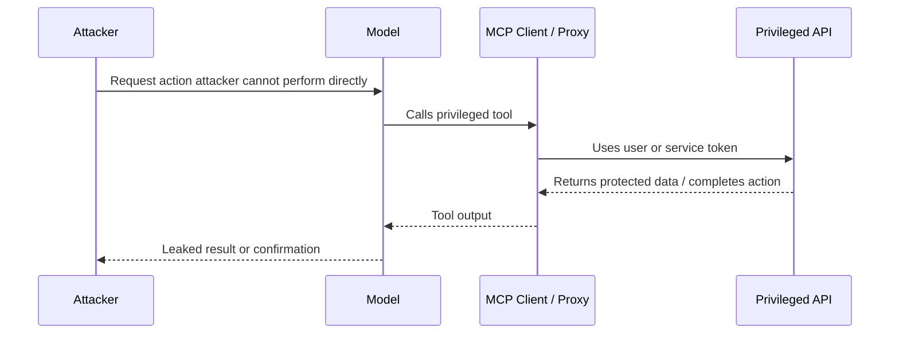

# 3.3 Identity and Authentication (`AUTHN`)

[← Chapter 3 overview](<3. MCP Threats and Attack Patterns.md>) · [Test case format](test-case-format.md)

## Overview

Authentication tests verify that **only intended principals** can open MCP sessions and that tokens are handled safely across host, server, and upstream APIs.

## Why this category matters

Remote MCP transports and multi-user hosts turn missing or weak authentication into direct capability access—often with powerful tools behind the session.

## Scope

Missing auth on server endpoints, token storage on the host, refresh/revocation behavior, credential reuse across tools or servers.

## When to prioritize

Critical for **remote** or **shared** MCP deployments. Still relevant for local stdio when tokens gate upstream APIs.

## Related categories

[AUTHZ](3.04-authorization-permission.md), [TRNS](3.15-transport-channel.md), [SECR](3.17-secrets-credentials.md)

## Common test chains

AUTHN-02 (weak tokens) → AUTHZ-03 (cross-user access); AUTHN-04 (revoked tokens) → GW-01 (gateway trust).

## Threats and attack patterns

Authentication failures below are quoted from the MCP authorization specification, the project’s security best-practices document (28 July 2026), and product advisories. They are distinct from “the model was talked into calling a tool,” which is covered in [3.7](3.07-prompt-instruction.md).

### HTTP and SSE transports shipped with no authentication

Three reviewed advisories describe network transports that accepted MCP requests with no credential:

- [CVE-2026-40576](https://github.com/advisories/GHSA-j98m-w3xp-9f56), `excel-mcp-server` through 0.1.7. The advisory says FastMCP SSE and Streamable HTTP transports ship with no authentication and this server adds none. Any TCP client that can reach the listen port can call the tools. The default stdio path is a different exposure (local process, not this CVE’s remote case).
- [CVE-2026-59971](https://osv.dev/vulnerability/CVE-2026-59971), MySQL MCP Server before 0.4.2. The CVE lists CWE-306 (missing authentication for a critical function) and CWE-346. With `MCP_TRANSPORT=sse`, a network attacker can reach `execute_sql`, or a browser can be led to that local service by DNS rebinding. Stdio is stated as not affected. Fixed in 0.4.2.
- `mcp-atlassian` before 0.17.0. [CVE-2026-27826](https://github.com/advisories/GHSA-7r34-79r5-rcc9) says an unauthenticated caller who can reach the HTTP endpoint can supply `X-Atlassian-Jira-Url` or `X-Atlassian-Confluence-Url` and cause the server to request that URL. No `Authorization` header is required. The advisory says the flaw is in HTTP middleware, not in a tool handler.

**Tests:** `MCPSTG-AUTHN-01`. Pair with `MCPSTG-CONF-02` so the report records bind address and transport, not only “login was missing.”

### Token passthrough and audience mix-up

The authorization specification forbids a server from forwarding the client’s token upstream, and requires the server to accept only tokens issued for itself.

> “MCP servers MUST only accept tokens specifically intended for themselves and MUST reject tokens that do not include them in the audience claim or otherwise verify that they are the intended recipient of the token.”
>
> — [Authorization security considerations](https://modelcontextprotocol.io/specification/2026-07-28/basic/authorization/security-considerations), Model Context Protocol (28 July 2026)

The security best-practices document names the anti-pattern and two consequences: audience validation failure, and forwarding an unmodified token so a downstream API treats the MCP server as a confused deputy.

> “Token passthrough” is an anti-pattern where an MCP server accepts tokens from an MCP client without validating that the tokens were properly issued to the MCP server and passes them through to the downstream API.
>
> — [Security Best Practices](https://modelcontextprotocol.io/docs/2026-07-28/tutorials/security/security_best_practices), Token Passthrough

The same document describes an OAuth mix-up attack (RFC 9207): a client that talks to many authorization servers can be induced to send an authorization code or token from an honest server to an attacker-controlled authorization server. PKCE alone does not stop that, because the client would send the `code_verifier` to the attacker’s token endpoint. The stated mitigation is checking the `iss` parameter from the authorization response.

**Tests:** `MCPSTG-AUTHN-02`, `MCPSTG-AUTHN-03`. Logging impact of opaque upstream tokens is in [3.12](3.12-logging-detection.md).

### Confused deputy on an MCP proxy

When an MCP server is a single static OAuth client in front of a third-party API, and it lets MCP clients register dynamically, the third-party authorization server can remember consent for the static client ID and skip the consent screen on a later request.

> “This attack allows malicious clients to obtain authorization codes without proper user consent by exploiting the combination of static client IDs, dynamic client registration, and consent cookies.”
>
> — [Security Best Practices](https://modelcontextprotocol.io/docs/2026-07-28/tutorials/security/security_best_practices), Confused Deputy Problem

The documented condition is all of the following: static client ID toward the third-party authorization server, dynamic client registration for MCP clients, a consent cookie set after the first authorization, and no per-client consent check before the proxy forwards the user. The required countermeasure in that document is a per-user registry of approved `client_id` values, an MCP-level consent page that shows the redirect URI, and exact redirect-URI matching.

**Tests:** `MCPSTG-AUTHN-02`, `MCPSTG-AUTHN-03`, and `MCPSTG-AUTHZ-02` for the consent screen itself.

### A crafted OAuth metadata URL is an authentication-flow bug, not a phishing mail

[CVE-2025-6514](https://www.cve.org/CVERecord?id=CVE-2025-6514) (also [GHSA-6xpm-ggf7-wc3p](https://github.com/advisories/ghsa-6xpm-ggf7-wc3p)) describes `mcp-remote` versions 0.0.5 through 0.1.15. CVE’s text:

> “mcp-remote is exposed to OS command injection when connecting to untrusted MCP servers due to crafted input from the authorization_endpoint response URL.”
>
> — CVE-2025-6514, [CVE Record](https://www.cve.org/CVERecord?id=CVE-2025-6514) (published 9 July 2025)

CVE assigns CWE-78 and CVSS 3.1 9.6 (`CVSS:3.1/AV:N/AC:L/PR:N/UI:R/S:C/C:H/I:H/A:H`). JFrog, who disclosed it, states the fix is `mcp-remote` 0.1.16 and that the trigger is a connection to an untrusted MCP server that returns a crafted `authorization_endpoint` ([JFrog write-up](https://jfrog.com/blog/2025-6514-critical-mcp-remote-rce-vulnerability/)). The MCP security document now says clients must allow only `http` and `https` authorization URLs, reject schemes such as `javascript:` and `file:`, and must not open URLs through a shell. Transport detail is in [3.15](3.15-transport-channel.md).

**Tests:** `MCPSTG-AUTHN-02`. A lab check is “which URL does the client open, and with which API,” not a copy of an exploit string.

### Revocation only works if the resource server asks

This guide did not find a named MCP CVE whose only defect was acceptance of an already-revoked token. The authorization specification still requires resource servers to validate access tokens per OAuth 2.1 section 5.2, including audience. A token that remains useful after logout or after the upstream user is disabled is the failure `MCPSTG-AUTHN-04` looks for. Broad scopes make that window worse; the security best-practices document’s scope-minimization section says a stolen token that already carries every scope in `scopes_supported` can call high-risk tools without a further elevation prompt. See [3.4](3.04-authorization-permission.md).

### Canonical attack patterns

The write-ups below moved here from the threats chapter. Each one names the abuse, a lab-safe example, the impact, red flags, and defensive checks. Published cases earlier in this section remain the sourced record. Use both when you choose tests.

### Confused Deputy Issues

**Tests:** `MCPSTG-AUTHN-03`, `MCPSTG-AUTHZ-04`.

A confused deputy issue occurs when a more privileged system is tricked into performing an action for a less privileged attacker. In MCP systems, the model, MCP client, or MCP proxy server may act as the deputy.

The attacker does not need direct access to the target system. They only need to influence an MCP-connected component that already has access.

#### Common MCP confused deputy cases

* A malicious client tricks an MCP proxy into obtaining tokens for a third-party API.
* An attacker-controlled document instructs the assistant to call an internal admin tool.
* A low-privilege user gets the assistant to use a high-privilege service token.
* A tool accepts client-supplied tokens and forwards them downstream without validating audience or scope.
* A model uses the wrong user identity when executing an action.
* An MCP proxy that uses one static OAuth client ID for every user lets a later, attacker-registered client skip the upstream consent screen because a consent cookie from an earlier approval is still in the browser. That protocol-level case is written up in [Authorization-Flow Abuse](#authorization-flow-abuse).

#### Example scenario

```text
Attacker cannot access internal HR API.
Assistant can access HR API through an MCP tool.
Attacker sends a crafted request asking the assistant to “verify” employee data.
Assistant calls the HR tool using privileged credentials.
Attacker receives summarized HR data.
```

#### Attack flow



#### Impact

* Unauthorized data access.
* Unauthorized changes in internal systems.
* OAuth consent bypass.
* Cross-tenant or cross-user data exposure.
* Audit trails that blame the assistant or service account instead of the attacker.

#### Red flags

* Tools using shared service accounts for user-specific actions.
* Missing per-user authorization checks at the tool layer.
* Token passthrough without audience validation.
* Broad admin tokens available to general assistant workflows.
* Consent screens that do not clearly show client, scopes, and redirect destinations.

#### Defensive guidance

* Enforce authorization at the MCP server and downstream API, not only in the prompt.
* Bind actions to the actual user identity and tenant.
* Validate token audience, issuer, scope, expiry, and subject.
* Avoid token passthrough patterns.
* Require per-client consent for proxy-style MCP authorization flows.
* Use least-privilege tokens and just-in-time access.
* Log user identity, client identity, server identity, tool name, scopes, and arguments for every privileged action.

### Authorization-Flow Abuse

**Tests:** `MCPSTG-AUTHN-02`, `MCPSTG-AUTHN-03`, `MCPSTG-AUTHZ-02`.

Confused Deputy Issues is the deputy you can explain to a developer: the assistant has a key the attacker does not. This section is the deputy inside OAuth. The MCP authorization guidance spends most of its threat model here, because a proxy server, a dynamic client, and a third-party API create a small crowd of identities, and it is easy to check the wrong one. ([Model Context Protocol](https://modelcontextprotocol.io/docs/2026-07-28/tutorials/security/security_best_practices))

#### Consent skipped because an earlier user already said yes

Picture an MCP server that sits in front of a third-party API and uses one fixed OAuth client ID for every MCP client. The first person to connect approves that client. The authorization server drops a consent cookie in the browser. Later, an attacker registers their own MCP client, with their own redirect URI, and sends the victim a crafted authorization link. The upstream server sees the familiar client ID and the cookie, skips the prompt, and the proxy forwards the authorization code to the attacker’s redirect. The victim never saw a second consent screen.

The proxy has to remember consent **per MCP client**, not per upstream client ID. The consent record should exist only after the person approves it. The `redirect_uri` should match the registered value exactly, the OAuth `state` value should be single-use, and the cookie that tracks that state should not be written before the approval click. Framing the consent page, or hiding it in an iframe, is part of the same bug family.

#### Token passthrough

Token passthrough means the MCP server accepts an access token that was minted for someone else and then shows that same token to a downstream API. Two failures stack. First, the server never checks that it is the token’s audience, so a token stolen from another app is good enough to get in. Second, the downstream API sees a token it may trust for reasons that have nothing to do with this MCP server.

The authorization spec forbids the pattern. Servers should accept only tokens issued for themselves, following ordinary OAuth 2.1 checks on issuer, audience, expiry, and signature. When the server calls an upstream API, that call needs its own credential. Clients should send RFC 8707 resource indicators so the token is bound to the MCP server and cannot be replayed next door. ([Model Context Protocol](https://modelcontextprotocol.io/specification/2026-07-28/basic/authorization/security-considerations)) ([RFC 8707](https://www.rfc-editor.org/rfc/rfc8707))

A passthrough proxy also wrecks the audit log. The MCP server cannot tell clients apart if they all arrive with an opaque upstream token, and the downstream log attributes the call to whoever the token was originally for.

#### Mix-up, and the localhost redirect that is not really yours

A client talks to many authorization servers over its life. A mix-up attack, described in RFC 9207, tries to make the client hand an authorization code from an honest server to an attacker’s token endpoint. ([RFC 9207](https://www.rfc-editor.org/rfc/rfc9207)) PKCE does not stop that on its own, because the client will happily send the code verifier to the wrong place. Binding the response to the issuer the client recorded before the redirect does.

Native clients add a second wrinkle. A Client ID Metadata Document can prove that someone controls a website. It cannot prove which process is listening on `127.0.0.1`. An attacker can present a legitimate client’s metadata URL as their `client_id`, bind their own localhost port as the redirect, and catch the code when the user approves a screen that shows the real client’s name. Authorization servers need to show that redirect host in the consent UI and treat localhost-only redirects as a special case. ([Model Context Protocol](https://modelcontextprotocol.io/docs/2026-07-28/tutorials/security/security_best_practices))

#### Red flags

* One upstream OAuth client ID shared by every MCP client.
* Tokens accepted with no audience check, then forwarded unchanged.
* `redirect_uri` compared with a wildcard or a prefix.
* Consent or `state` cookies set before the user approves.
* Authorization endpoints that are not `https`, except loopback during local development.

#### Defensive guidance

* Store consent per user and per MCP `client_id`, and check it before starting the upstream flow.
* Reject any token whose audience is not this server.
* Take a fresh downstream credential. Leave the client’s token on the MCP side of the boundary.
* Match redirect URIs with exact string comparison. Make `state` random, single-use, and short-lived.
* Show the requesting client, the scopes, and the redirect host on the consent screen. Refuse to be iframed.

### Session and State-Handle Hijacking

**Tests:** `MCPSTG-AUTHN-02`, `MCPSTG-AUTHZ-03`, `MCPSTG-CTX-04`.

Older MCP transports handed the client a session ID and expected it back on later requests. If that ID was guessable, logged, or reused as proof of who you are, anyone holding it could ride the session. Shared event queues made this worse: a second party with the ID could inject events the real client would then read.

The current protocol is explicit that MCP itself is stateless. A server that needs to remember a shopping cart, a workflow, or a multi-step approval mints a **state handle** and gets it back as an ordinary tool argument. The failure mode moved with the design. If the server treats “you quoted the handle” as “you are the user who created it,” a guessed or leaked handle is cross-user access. The security best practices call this out directly: possession of a handle is not authentication. ([Model Context Protocol](https://modelcontextprotocol.io/docs/2026-07-28/tutorials/security/security_best_practices))

#### Attack flow

```text
Server mints a handle for user A and returns it in a tool result
        |
        v
Handle lands in a log, a ticket, a model summary, or a guessable sequence
        |
        v
User B calls the same tool with that handle
        |
        v
Server mutates user A's state because it never bound the handle to A
```

#### Impact

* One user’s workflow, files, or pending approval becomes another user’s.
* Incident timelines blame the account that owns the handle, which is the victim.
* Event injection on older session-based servers can plant tool results the client will trust.

#### Red flags

* Session IDs or handles used as the only check on a request.
* Sequential or short identifiers.
* Handles echoed into model-visible tool output, tickets, or debug logs.
* Resumed streams that do not re-check the access token.

#### Defensive guidance

* Authenticate every request. Bind stored state to the user id from the verified token, and reject a handle presented by anyone else.
* Generate handles with a cryptographic random source. Expire them.
* On protocol revisions that still use session IDs, keep the same rules: random, bound to the user, never a substitute for the token.
* Keep handles out of model context when the model does not need to see them.

## Enterprise identity at the gateway

If the gateway multiplexes SaaS tenants, validate the JWT `aud` and `tid` claims (or the equivalent tenant claim) before routing `tools/call` to a backend MCP server. Use separate OAuth client IDs for development, stage, and production.

The rest of the routing decision is in [3.16](3.16-gateway-egress.md#per-tenant-routing). Transport separation across environments is in [3.15](3.15-transport-channel.md#separate-oauth-clients-per-environment).

## Test cases

Each test below is explained in this section with summary, scenario, step-by-step guidance, **example MCP code snippets**, expected results, and remediation. Use **View** to jump to a test.

| ID | Test case | Risk | Type | View |
|----|-----------|------|------|------|
| `MCPSTG-AUTHN-01` | Test Missing Authentication on MCP Server | Critical | Hybrid | [View](#mcpstg-authn-01) |
| `MCPSTG-AUTHN-02` | Test Weak Token Handling | High | Hybrid | [View](#mcpstg-authn-02) |
| `MCPSTG-AUTHN-03` | Test Credential Reuse Across Tools | High | Manual | [View](#mcpstg-authn-03) |
| `MCPSTG-AUTHN-04` | Test Expired or Revoked Token Acceptance | High | Hybrid | [View](#mcpstg-authn-04) |

### MCPSTG-AUTHN-01 — Test Missing Authentication on MCP Server

<a id="mcpstg-authn-01"></a>

#### Summary

An MCP server exposed on a **network transport** without authentication allows any client that can reach the port to list tools, read resources, and invoke side-effecting capabilities. Even “internal only” networks are often broader than assumed (VPN split tunneling, compromised laptops, mis-routed VPC peering). **Stdio** transports shift risk to **local process** spawning but do not remove authorization requirements if multiple principals share a machine.

#### Scenario

- **Remote MCP** listens on `0.0.0.0` in a container with wide security groups “for debugging.”
- **Attacker position:** Any internal host that can route to the port; malware on a developer laptop during off-VPN periods.
- **Potential impact:** Remote code paths via dangerous tools, data exfiltration via resources, lateral movement.

#### Test Objectives

- Verify unauthenticated clients cannot complete MCP initialization or tool calls (for deployments that claim authentication).
- Verify **network binding** is loopback-only or behind authenticated mesh where policy requires it.
- Verify stdio servers are **not** accidentally exposed via TCP wrappers or socat tunnels left running.

#### Preconditions

- Lab clone of the service topology; no testing against production without explicit scope.
- Secondary machine or network namespace in lab to simulate non-client origin if authorized.

#### How to Test

##### 1. Manual Review

Read deployment guide: is authentication mandatory or “optional for internal”?

##### 2. Configuration Review

- Firewall rules, bind addresses, `docker port` mappings, Kubernetes `Service` types (`LoadBalancer` vs `ClusterIP`).
- Auth middleware order: authentication before capability negotiation.

##### 3. Runtime Testing

1. From an **unauthorized** lab client (no token / wrong mTLS cert), call `initialize` and `tools/list`—expect **fail** if auth is required.
2. From authorized client—expect success.
3. For stdio-only servers, verify no auxiliary HTTP admin port is exposed without auth.

##### 4. Abuse Case Testing

- Replay a captured `Authorization` header from a different lab session id—expect rejection if session-bound.

##### 5. Log and Detection Review

**Detection:** failed auth spikes, connections from unexpected CIDRs, successful anonymous tool calls (should be impossible if policy says otherwise).

#### Test Data / Example Payloads

Use synthetic bearer strings: `Authorization: Bearer lab-invalid-token`.

#### Expected Results

- **Secure:** anonymous access impossible; bind addresses match policy; auth enforced before tools/resources.
- **Insecure:** anonymous `tools/call` succeeds; server listens on all interfaces without TLS in sensitive zones.
- **Evidence:** redacted tcpdump summaries, config diffs, audit logs.

#### Remediation

- Require mutual TLS or OAuth for remote MCP; place behind authenticated gateway by default.
- Bind to localhost for dev; use SSH tunnels instead of wide SGs where possible.
- Add health checks that fail deployment if auth modules are disabled (`MCPSTG-CONF-01`).

#### Tools

- `nmap` / `nc` in lab, authenticated curl, service mesh policy debug CLIs.

#### References

- OWASP API Security Top 10: API2 Authentication Failures.
- OWASP ASVS: V2 Authentication.
- CWE-306: Missing Authentication for Critical Function

#### Mapping

- [OWASP API Security Top 10](https://owasp.org/API-Security/): [API2:2023 Broken Authentication](https://owasp.org/API-Security/editions/2023/en/0xa2-broken-authentication/)
- [OWASP ASVS](https://owasp.org/www-project-application-security-verification-standard/): [V2 Authentication](https://github.com/OWASP/ASVS/blob/master/5.0/en/0x12-V2-Authentication.md)
- [MCP specification (versioned)](https://modelcontextprotocol.io/): authorization extensions (cite version tested)
- [CWE](https://cwe.mitre.org/): [CWE-306 (Missing Authentication for Critical Function)](https://cwe.mitre.org/data/definitions/306.html)
- Risk level: Critical
- Testing type: Hybrid

### MCPSTG-AUTHN-02 — Test Weak Token Handling

<a id="mcpstg-authn-02"></a>

#### Summary

This test evaluates **test weak token handling** in MCP deployments. It focuses on identity proof and token handling on MCP transports. Failures often appear only when hosts, servers, tools, and upstream APIs are composed—single-component review is not enough.

#### Scenario

- **MCP host/client:** `<TEST_USER>` on a lab workstation with an MCP host config block (see **Example snippets**).
- **MCP server:** `<AUTHORIZED_LAB_SERVER>` under `<TEST_WORKSPACE>`.
- **Tools/resources:** `<TEST_TOOL_NAME>`, `<TEST_RESOURCE>` (synthetic lab fixtures only).
- **Trust boundary:** host ↔ MCP server ↔ OS ↔ upstream APIs.
- **Attacker position:** malicious prompt, compromised server package, or abusive automation (lab-safe only).
- **Potential impact:** confidentiality, integrity, availability, or cost abuse depending on control gaps.

#### Test Objectives

- Confirm insecure behavior is absent or mitigated for **test weak token handling**.
- Identify missing controls (authorization, validation, egress policy, logging, rate limits).
- Document **secure** behavior under the same lab inputs.

#### Preconditions

- Authorized lab environment and written scope.
- Access to host configuration, MCP server configuration, and (if applicable) gateway policy.
- Test principal `<TEST_USER>`; secondary account if testing cross-user issues.
- Log access for host, gateway, and MCP server.

#### How to Test

##### 1. Manual Review

Review documentation, tool metadata, permission manifests, and architecture diagrams for gaps related to test weak token handling.

##### 2. Configuration Review

Inspect host MCP config, server env vars, transport settings, and gateway rules (redact secrets in evidence).

##### 3. Runtime Testing

1. Connect the lab host to `<AUTHORIZED_LAB_SERVER>` using the snippet in **Example snippets**.
2. Capture baseline `tools/list` (and `resources/list` if applicable).
3. Execute bounded runtime checks with synthetic arguments only.
4. Record host, server, and gateway responses plus redacted logs.

##### 4. Abuse Case Testing

Attempt bounded mutations: alternate principals, repeated calls, parameter edge cases, or sequencing—**no** destructive payloads or third-party targets.

##### 5. Log and Detection Review

Confirm logs include tool name, principal, decision, outcome, and correlation IDs without leaking secrets.

#### Example snippets

Lab host configuration (redact secrets before sharing evidence):

```json
{
  "mcpServers": {
    "<AUTHORIZED_LAB_SERVER>": {
      "command": "node",
      "args": ["<TEST_WORKSPACE>/servers/lab-server/index.js"],
      "env": {
        "WORKSPACE_ROOT": "<TEST_WORKSPACE>"
      }
    }
  }
}
```

Invoke a tool with synthetic arguments:

```json
{
  "jsonrpc": "2.0",
  "id": 2,
  "method": "tools/call",
  "params": {
    "name": "<TEST_TOOL_NAME>",
    "arguments": {
      "query": "benign-lab-string-123",
      "workspace": "<TEST_WORKSPACE>"
    }
  }
}
```

Remote transport auth header (example):

```http
POST /mcp HTTP/1.1
Authorization: Bearer <LAB_TOKEN>
Content-Type: application/json

{"jsonrpc":"2.0","id":1,"method":"tools/list"}
```

#### Test Data / Example Payloads

Use synthetic placeholders only. Replace `<TEST_*>` values with [Safe lab fixtures](test-case-format.md#safe-lab-fixtures) fixtures.

#### Expected Results

- **Secure:** policy blocks or contains abuse; stable deny/alert reason codes; limits and approvals enforced.
- **Insecure:** missing controls allow the abuse described in the summary; sensitive effects occur without detection.
- **Evidence:** redacted logs, config excerpts, snippet request/response pairs, policy screenshots.

#### Remediation

Apply least privilege, strong defaults, human approval for high-risk tools, input/output controls, gateway egress rules, rate limits, idempotency for writes, and secret hygiene.

#### Tools

MCP client utilities, HTTP/TLS proxies, structured log search, dependency scanners, and policy-as-code test harnesses (see [Testing tools](test-case-format.md#testing-tools)).

#### References

- Model Context Protocol documentation (cite version tested).
- OWASP LLM Top 10, OWASP API Security Top 10, OWASP ASVS where applicable.
- CWE and MITRE ATLAS where mappings are credible.

#### Mapping

- [OWASP API Security Top 10](https://owasp.org/API-Security/): [API2:2023 Broken Authentication](https://owasp.org/API-Security/editions/2023/en/0xa2-broken-authentication/)
- [OWASP ASVS](https://owasp.org/www-project-application-security-verification-standard/): [V2.2](https://github.com/OWASP/ASVS/blob/master/5.0/en/0x12-V2-Authentication.md), [V3.5](https://github.com/OWASP/ASVS/blob/master/5.0/en/0x13-V3-Session-management.md) (session and token handling)
- [CWE](https://cwe.mitre.org/): [CWE-287 (Improper Authentication)](https://cwe.mitre.org/data/definitions/287.html), [CWE-521 (Weak Password Requirements — token entropy analog)](https://cwe.mitre.org/data/definitions/521.html)
- Risk level: High
- Testing type: Hybrid

### MCPSTG-AUTHN-03 — Test Credential Reuse Across Tools

<a id="mcpstg-authn-03"></a>

#### Summary

This test evaluates **test credential reuse across tools** in MCP deployments. It focuses on identity proof and token handling on MCP transports. Failures often appear only when hosts, servers, tools, and upstream APIs are composed—single-component review is not enough.

#### Scenario

- **MCP host/client:** `<TEST_USER>` on a lab workstation with an MCP host config block (see **Example snippets**).
- **MCP server:** `<AUTHORIZED_LAB_SERVER>` under `<TEST_WORKSPACE>`.
- **Tools/resources:** `<TEST_TOOL_NAME>`, `<TEST_RESOURCE>` (synthetic lab fixtures only).
- **Trust boundary:** host ↔ MCP server ↔ OS ↔ upstream APIs.
- **Attacker position:** malicious prompt, compromised server package, or abusive automation (lab-safe only).
- **Potential impact:** confidentiality, integrity, availability, or cost abuse depending on control gaps.

#### Test Objectives

- Confirm insecure behavior is absent or mitigated for **test credential reuse across tools**.
- Identify missing controls (authorization, validation, egress policy, logging, rate limits).
- Document **secure** behavior under the same lab inputs.

#### Preconditions

- Authorized lab environment and written scope.
- Access to host configuration, MCP server configuration, and (if applicable) gateway policy.
- Test principal `<TEST_USER>`; secondary account if testing cross-user issues.
- Log access for host, gateway, and MCP server.

#### How to Test

##### 1. Manual Review

Review documentation, tool metadata, permission manifests, and architecture diagrams for gaps related to test credential reuse across tools.

##### 2. Configuration Review

Inspect host MCP config, server env vars, transport settings, and gateway rules (redact secrets in evidence).

##### 3. Runtime Testing

1. Connect the lab host to `<AUTHORIZED_LAB_SERVER>` using the snippet in **Example snippets**.
2. Capture baseline `tools/list` (and `resources/list` if applicable).
3. Execute bounded runtime checks with synthetic arguments only.
4. Record host, server, and gateway responses plus redacted logs.

##### 4. Abuse Case Testing

Attempt bounded mutations: alternate principals, repeated calls, parameter edge cases, or sequencing—**no** destructive payloads or third-party targets.

##### 5. Log and Detection Review

Confirm logs include tool name, principal, decision, outcome, and correlation IDs without leaking secrets.

#### Example snippets

Lab host configuration (redact secrets before sharing evidence):

```json
{
  "mcpServers": {
    "<AUTHORIZED_LAB_SERVER>": {
      "command": "node",
      "args": ["<TEST_WORKSPACE>/servers/lab-server/index.js"],
      "env": {
        "WORKSPACE_ROOT": "<TEST_WORKSPACE>"
      }
    }
  }
}
```

Invoke a tool with synthetic arguments:

```json
{
  "jsonrpc": "2.0",
  "id": 2,
  "method": "tools/call",
  "params": {
    "name": "<TEST_TOOL_NAME>",
    "arguments": {
      "query": "benign-lab-string-123",
      "workspace": "<TEST_WORKSPACE>"
    }
  }
}
```

Remote transport auth header (example):

```http
POST /mcp HTTP/1.1
Authorization: Bearer <LAB_TOKEN>
Content-Type: application/json

{"jsonrpc":"2.0","id":1,"method":"tools/list"}
```

#### Test Data / Example Payloads

Use synthetic placeholders only. Replace `<TEST_*>` values with [Safe lab fixtures](test-case-format.md#safe-lab-fixtures) fixtures.

#### Expected Results

- **Secure:** policy blocks or contains abuse; stable deny/alert reason codes; limits and approvals enforced.
- **Insecure:** missing controls allow the abuse described in the summary; sensitive effects occur without detection.
- **Evidence:** redacted logs, config excerpts, snippet request/response pairs, policy screenshots.

#### Remediation

Apply least privilege, strong defaults, human approval for high-risk tools, input/output controls, gateway egress rules, rate limits, idempotency for writes, and secret hygiene.

#### Tools

MCP client utilities, HTTP/TLS proxies, structured log search, dependency scanners, and policy-as-code test harnesses (see [Testing tools](test-case-format.md#testing-tools)).

#### References

- Model Context Protocol documentation (cite version tested).
- OWASP LLM Top 10, OWASP API Security Top 10, OWASP ASVS where applicable.
- CWE and MITRE ATLAS where mappings are credible.

#### Mapping

- [OWASP API Security Top 10](https://owasp.org/API-Security/): [API2:2023 Broken Authentication](https://owasp.org/API-Security/editions/2023/en/0xa2-broken-authentication/)
- [OWASP ASVS](https://owasp.org/www-project-application-security-verification-standard/): [V2.1](https://github.com/OWASP/ASVS/blob/master/5.0/en/0x12-V2-Authentication.md), [V3.3](https://github.com/OWASP/ASVS/blob/master/5.0/en/0x13-V3-Session-management.md) (credential and session separation)
- [CWE](https://cwe.mitre.org/): [CWE-384 (Session Fixation)](https://cwe.mitre.org/data/definitions/384.html), [CWE-200 (credential bleed across contexts)](https://cwe.mitre.org/data/definitions/200.html)
- Risk level: High
- Testing type: Manual

### MCPSTG-AUTHN-04 — Test Expired or Revoked Token Acceptance

<a id="mcpstg-authn-04"></a>

#### Summary

This test evaluates **test expired or revoked token acceptance** in MCP deployments. It focuses on identity proof and token handling on MCP transports. Failures often appear only when hosts, servers, tools, and upstream APIs are composed—single-component review is not enough.

#### Scenario

- **MCP host/client:** `<TEST_USER>` on a lab workstation with an MCP host config block (see **Example snippets**).
- **MCP server:** `<AUTHORIZED_LAB_SERVER>` under `<TEST_WORKSPACE>`.
- **Tools/resources:** `<TEST_TOOL_NAME>`, `<TEST_RESOURCE>` (synthetic lab fixtures only).
- **Trust boundary:** host ↔ MCP server ↔ OS ↔ upstream APIs.
- **Attacker position:** malicious prompt, compromised server package, or abusive automation (lab-safe only).
- **Potential impact:** confidentiality, integrity, availability, or cost abuse depending on control gaps.

#### Test Objectives

- Confirm insecure behavior is absent or mitigated for **test expired or revoked token acceptance**.
- Identify missing controls (authorization, validation, egress policy, logging, rate limits).
- Document **secure** behavior under the same lab inputs.

#### Preconditions

- Authorized lab environment and written scope.
- Access to host configuration, MCP server configuration, and (if applicable) gateway policy.
- Test principal `<TEST_USER>`; secondary account if testing cross-user issues.
- Log access for host, gateway, and MCP server.

#### How to Test

##### 1. Manual Review

Review documentation, tool metadata, permission manifests, and architecture diagrams for gaps related to test expired or revoked token acceptance.

##### 2. Configuration Review

Inspect host MCP config, server env vars, transport settings, and gateway rules (redact secrets in evidence).

##### 3. Runtime Testing

1. Connect the lab host to `<AUTHORIZED_LAB_SERVER>` using the snippet in **Example snippets**.
2. Capture baseline `tools/list` (and `resources/list` if applicable).
3. Execute bounded runtime checks with synthetic arguments only.
4. Record host, server, and gateway responses plus redacted logs.

##### 4. Abuse Case Testing

Attempt bounded mutations: alternate principals, repeated calls, parameter edge cases, or sequencing—**no** destructive payloads or third-party targets.

##### 5. Log and Detection Review

Confirm logs include tool name, principal, decision, outcome, and correlation IDs without leaking secrets.

#### Example snippets

Lab host configuration (redact secrets before sharing evidence):

```json
{
  "mcpServers": {
    "<AUTHORIZED_LAB_SERVER>": {
      "command": "node",
      "args": ["<TEST_WORKSPACE>/servers/lab-server/index.js"],
      "env": {
        "WORKSPACE_ROOT": "<TEST_WORKSPACE>"
      }
    }
  }
}
```

Invoke a tool with synthetic arguments:

```json
{
  "jsonrpc": "2.0",
  "id": 2,
  "method": "tools/call",
  "params": {
    "name": "<TEST_TOOL_NAME>",
    "arguments": {
      "query": "benign-lab-string-123",
      "workspace": "<TEST_WORKSPACE>"
    }
  }
}
```

Remote transport auth header (example):

```http
POST /mcp HTTP/1.1
Authorization: Bearer <LAB_TOKEN>
Content-Type: application/json

{"jsonrpc":"2.0","id":1,"method":"tools/list"}
```

#### Test Data / Example Payloads

Use synthetic placeholders only. Replace `<TEST_*>` values with [Safe lab fixtures](test-case-format.md#safe-lab-fixtures) fixtures.

#### Expected Results

- **Secure:** policy blocks or contains abuse; stable deny/alert reason codes; limits and approvals enforced.
- **Insecure:** missing controls allow the abuse described in the summary; sensitive effects occur without detection.
- **Evidence:** redacted logs, config excerpts, snippet request/response pairs, policy screenshots.

#### Remediation

Apply least privilege, strong defaults, human approval for high-risk tools, input/output controls, gateway egress rules, rate limits, idempotency for writes, and secret hygiene.

#### Tools

MCP client utilities, HTTP/TLS proxies, structured log search, dependency scanners, and policy-as-code test harnesses (see [Testing tools](test-case-format.md#testing-tools)).

#### References

- Model Context Protocol documentation (cite version tested).
- OWASP LLM Top 10, OWASP API Security Top 10, OWASP ASVS where applicable.
- CWE and MITRE ATLAS where mappings are credible.

#### Mapping

- [OWASP API Security Top 10](https://owasp.org/API-Security/): [API2:2023 Broken Authentication](https://owasp.org/API-Security/editions/2023/en/0xa2-broken-authentication/)
- [OWASP ASVS](https://owasp.org/www-project-application-security-verification-standard/): [V3.3](https://github.com/OWASP/ASVS/blob/master/5.0/en/0x13-V3-Session-management.md) (session termination and token invalidation)
- [CWE](https://cwe.mitre.org/): [CWE-613 (Insufficient Session Expiration)](https://cwe.mitre.org/data/definitions/613.html), [CWE-294 (Authentication Bypass by Capture-replay)](https://cwe.mitre.org/data/definitions/294.html)
- Risk level: High
- Testing type: Hybrid
