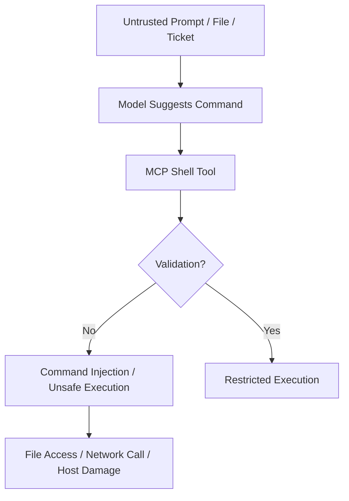

# 3.10 Input Validation (`INPV`)

[← Chapter 3 overview](<3. MCP Threats and Attack Patterns.md>) · [Test case format](test-case-format.md)

## Overview

Input validation tests focus on **tool arguments**: type confusion, boundary checks, path traversal, and JSON/schema mismatches between what the host sends and what the server enforces.

## Why this category matters

Tools often wrap shell commands, file APIs, or SQL. Model-generated arguments are attacker-controlled input even when the user appears benign.

## Scope

Parameter validation, canonicalization, path joins, schema enforcement vs runtime behavior, nested JSON edge cases.

## When to prioritize

Critical for tools wrapping filesystem, shell, or query interfaces.

## Related categories

[TOOL](3.05-tool-security.md), [OUTV](3.11-output-handling.md)

## Common test chains

INPV-02 + RSRC-05; INPV-03 + TOOL-04 (schema manipulation).

## Threats and attack patterns

Input bugs below are defects in how a server or client handles a value the caller, or a remote MCP server, supplied. They are quoted from advisories. Crossing a filesystem root is also an authorization failure; see [3.4](3.04-authorization-permission.md) and [3.6](3.06-resource-data-access.md).

### Path parameters that ignore the configured directory

[CVE-2026-40576](https://github.com/advisories/GHSA-j98m-w3xp-9f56) says `excel-mcp-server` through 0.1.7 takes a `filepath` argument on its tool handlers and passes it to `get_excel_path()`. The advisory says that function does not enforce `EXCEL_FILES_PATH`: absolute paths are returned as given, and relative paths are joined without a resolve-and-check. The advisory’s precondition for remote use is the SSE or Streamable HTTP transport, default bind `0.0.0.0`, and no authentication. Fixed versions are those after 0.1.7; confirm the patched release in the advisory before you cite a fix version in a report.

[CVE-2026-27825](https://github.com/advisories/GHSA-xjgw-4wvw-rgm4), `mcp-atlassian` before 0.17.0, is the write path. `download_path` on `confluence_download_attachment` is used as the output file. The advisory says `os.path.abspath()` does not constrain the directory, and `target_dir` on `download_content_attachments` is the same class of parameter. Fixed in 0.17.0.

**Tests:** `MCPSTG-INPV-02`. Include both an absolute path and a relative path that leaves the root after resolution. Record the process user’s rights, because the advisory’s impact is “any path the server process can write,” not “any path on the machine.”

### Command and query strings reached an interpreter

[CVE-2025-6514](https://www.cve.org/CVERecord?id=CVE-2025-6514) is CWE-78 in an MCP client. `mcp-remote` 0.0.5 through 0.1.15 takes `authorization_endpoint` from the MCP server’s OAuth metadata and, per the CVE text, is exposed to OS command injection from that URL. CVSS 3.1 9.6. Fixed in 0.1.16 ([GHSA-6xpm-ggf7-wc3p](https://github.com/advisories/ghsa-6xpm-ggf7-wc3p); [JFrog](https://jfrog.com/blog/2025-6514-critical-mcp-remote-rce-vulnerability/)). The MCP security document’s rule that matches this bug: clients must not open authorization URLs by invoking a shell ([Security Best Practices](https://modelcontextprotocol.io/docs/2026-07-28/tutorials/security/security_best_practices), 28 July 2026 docs).

[CVE-2026-59971](https://osv.dev/vulnerability/CVE-2026-59971) is the SQL form. Before MySQL MCP Server 0.4.2, a query supplied to `execute_sql` reaches `cursor.execute` on an SSE transport that the CVE says does not authenticate. That is missing authentication and missing query restriction together. The CVE does not describe a separate sanitizer bypass on the stdio transport.

Checkmarx’s 1 October 2025 report on `@lanyer640/mcp-runcommand-server` says version 1.0.5 executed received commands with `shell: true` and without authentication, and version 1.0.6 added a reverse shell ([Checkmarx Zero](https://checkmarx.com/zero-post/npm-malware-alert-lanyer640-mcp-runcommand-server-with-reverse-shell/)). The package was removed from the public npm registry. Treat any remaining cached copy as malicious, not as a validation bug to patch in place.

**Tests:** `MCPSTG-INPV-01`, `MCPSTG-TOOL-03`.

### Schema and extra fields

This guide did not find a CVE whose sole published defect was “an extra JSON field confused an MCP tool schema.” Two published patterns still belong in `MCPSTG-INPV-03`:

- Tool descriptions and parameter schemas are model-visible instructions. Invariant (1 April 2025) showed a parameter (`sidenote` in their demonstration tool) whose description told the model what to put in it, while the user interface did not show the full value. The schema was doing double duty as an injection point. See [3.5](3.05-tool-security.md). Do not copy that demonstration schema into a report; record whether your client displays every property the model is given.
- [CVE-2026-27826](https://github.com/advisories/GHSA-7r34-79r5-rcc9) is header-level schema confusion: `mcp-atlassian` treated `X-Atlassian-Jira-Url` and `X-Atlassian-Confluence-Url` as the base URL of the upstream product and did not validate the destination. The advisory says the first fetcher call then requested `{header url}/rest/api/2/myself`. The input is not a tool argument. It is still caller-controlled structured input that selected a network target. A later project advisory, [GHSA-72fm-whvq-jghf](https://github.com/sooperset/mcp-atlassian/security/advisories/GHSA-72fm-whvq-jghf), says the 0.17.0 check resolves the name at validation time and the HTTP client resolves it again when it connects, so the two lookups can differ.

OWASP API Security discusses mass assignment as a general API issue. Do not label a finding “mass assignment” unless the server actually binds client JSON onto an internal object. For MCP, the evidence to collect is: which fields the schema declares, which fields the handler reads, and which of those fields can change a path, a URL, a command, or a recipient.

**Tests:** `MCPSTG-INPV-03`.

### Canonical attack patterns

The write-ups below moved here from the threats chapter. Each one names the abuse, a lab-safe example, the impact, red flags, and defensive checks. Published cases earlier in this section remain the sourced record. Use both when you choose tests.

### Dangerous Command Execution

**Tests:** `MCPSTG-TOOL-02`, `MCPSTG-TOOL-03`, `MCPSTG-INPV-01`.

Dangerous command execution covers MCP tools that execute shell commands, scripts, build steps, package managers, database commands, infrastructure commands, or arbitrary code.

These tools are powerful because they let the assistant act like a developer or operator. They are also dangerous because untrusted input can become command arguments, file paths, package names, scripts, or environment variables.

#### Common risk patterns

* Command injection through unsanitized arguments.
* Unsafe string concatenation when building shell commands.
* Executing package install scripts from untrusted sources.
* Running generated code without sandboxing.
* Passing untrusted file paths to shell commands.
* Allowing network access during execution.
* Running local MCP servers with the same privileges as the user.
* Running tools from writable directories.

#### Unsafe implementation pattern

```python
# Unsafe pattern: untrusted input is concatenated into a shell command
command = "grep -R " + user_query + " ./project"
run_shell(command)
```

#### Safer implementation pattern

```python
# Safer pattern: avoid shell=True, pass arguments as a list, validate inputs
allowed_root = "./project"
query = validate_search_query(user_query)
run_process(["grep", "-R", query, allowed_root], shell=False)
```

#### Attack flow



#### Impact

* Remote or local code execution.
* Data theft from developer machines.
* File deletion or tampering.
* CI/CD compromise.
* Malware installation.
* Internal network reconnaissance.

#### Red flags

* Tools exposing `run_command`, `exec`, `eval`, `python`, `node`, `bash`, or `powershell` broadly.
* Tool descriptions claiming “can run any command.”
* User input passed directly into shell commands.
* Lack of sandboxing, timeouts, resource limits, or network restrictions.
* Commands generated from external content.

#### Defensive guidance

* Avoid arbitrary shell tools where possible.
* Replace general command execution with narrow, purpose-built tools.
* Use argument arrays rather than shell string concatenation.
* Validate commands, arguments, paths, and file extensions.
* Deny dangerous commands and patterns by policy.
* Run commands in a sandbox with minimal filesystem and network access.
* Use timeouts, CPU/memory limits, and working-directory restrictions.
* Require human approval for write, delete, install, network, or production-impacting commands.
* Log commands safely, with secret redaction.

### Execution safety

* Avoid generic shell tools.
* Prefer narrow, purpose-built tools.
* Validate all tool arguments server-side.
* Sandbox local servers and command execution.
* Restrict network access for local tools, and check URL destinations at connect time.
* Validate `Origin` and `Host` on any HTTP listener, including localhost.
* Open authorization URLs with a URL API, never a shell. Allow only `http` and `https`.
* Apply timeouts and resource limits.

## Test cases

Each test below is explained in this section with summary, scenario, step-by-step guidance, **example MCP code snippets**, expected results, and remediation. Use **View** to jump to a test.

| ID | Test case | Risk | Type | View |
|----|-----------|------|------|------|
| `MCPSTG-INPV-01` | Test Input Validation for Tool Parameters | High | Hybrid | [View](#mcpstg-inpv-01) |
| `MCPSTG-INPV-02` | Test Path Traversal in Tool Inputs | Critical | Hybrid | [View](#mcpstg-inpv-02) |
| `MCPSTG-INPV-03` | Test JSON and Schema Confusion | Medium | Hybrid | [View](#mcpstg-inpv-03) |

### MCPSTG-INPV-01 — Test Input Validation for Tool Parameters

<a id="mcpstg-inpv-01"></a>

#### Summary

This test evaluates **test input validation for tool parameters** in MCP deployments. It focuses on validation of tool inputs, paths, and schema confusion. Failures often appear only when hosts, servers, tools, and upstream APIs are composed—single-component review is not enough.

#### Scenario

- **MCP host/client:** `<TEST_USER>` on a lab workstation with an MCP host config block (see **Example snippets**).
- **MCP server:** `<AUTHORIZED_LAB_SERVER>` under `<TEST_WORKSPACE>`.
- **Tools/resources:** `<TEST_TOOL_NAME>`, `<TEST_RESOURCE>` (synthetic lab fixtures only).
- **Trust boundary:** host ↔ MCP server ↔ OS ↔ upstream APIs.
- **Attacker position:** malicious prompt, compromised server package, or abusive automation (lab-safe only).
- **Potential impact:** confidentiality, integrity, availability, or cost abuse depending on control gaps.

#### Test Objectives

- Confirm insecure behavior is absent or mitigated for **test input validation for tool parameters**.
- Identify missing controls (authorization, validation, egress policy, logging, rate limits).
- Document **secure** behavior under the same lab inputs.

#### Preconditions

- Authorized lab environment and written scope.
- Access to host configuration, MCP server configuration, and (if applicable) gateway policy.
- Test principal `<TEST_USER>`; secondary account if testing cross-user issues.
- Log access for host, gateway, and MCP server.

#### How to Test

##### 1. Manual Review

Review documentation, tool metadata, permission manifests, and architecture diagrams for gaps related to test input validation for tool parameters.

##### 2. Configuration Review

Inspect host MCP config, server env vars, transport settings, and gateway rules (redact secrets in evidence).

##### 3. Runtime Testing

1. Connect the lab host to `<AUTHORIZED_LAB_SERVER>` using the snippet in **Example snippets**.
2. Capture baseline `tools/list` (and `resources/list` if applicable).
3. Execute bounded runtime checks with synthetic arguments only.
4. Record host, server, and gateway responses plus redacted logs.

##### 4. Abuse Case Testing

Attempt bounded mutations: alternate principals, repeated calls, parameter edge cases, or sequencing—**no** destructive payloads or third-party targets.

##### 5. Log and Detection Review

Confirm logs include tool name, principal, decision, outcome, and correlation IDs without leaking secrets.

#### Example snippets

Lab host configuration (redact secrets before sharing evidence):

```json
{
  "mcpServers": {
    "<AUTHORIZED_LAB_SERVER>": {
      "command": "node",
      "args": ["<TEST_WORKSPACE>/servers/lab-server/index.js"],
      "env": {
        "WORKSPACE_ROOT": "<TEST_WORKSPACE>"
      }
    }
  }
}
```

Discover exposed tools:

```json
{
  "jsonrpc": "2.0",
  "id": 1,
  "method": "tools/list"
}
```

Invoke a tool with synthetic arguments:

```json
{
  "jsonrpc": "2.0",
  "id": 2,
  "method": "tools/call",
  "params": {
    "name": "<TEST_TOOL_NAME>",
    "arguments": {
      "query": "benign-lab-string-123",
      "workspace": "<TEST_WORKSPACE>"
    }
  }
}
```

#### Test Data / Example Payloads

Use synthetic placeholders only. Replace `<TEST_*>` values with [Safe lab fixtures](test-case-format.md#safe-lab-fixtures) fixtures.

#### Expected Results

- **Secure:** policy blocks or contains abuse; stable deny/alert reason codes; limits and approvals enforced.
- **Insecure:** missing controls allow the abuse described in the summary; sensitive effects occur without detection.
- **Evidence:** redacted logs, config excerpts, snippet request/response pairs, policy screenshots.

#### Remediation

Apply least privilege, strong defaults, human approval for high-risk tools, input/output controls, gateway egress rules, rate limits, idempotency for writes, and secret hygiene.

#### Tools

MCP client utilities, HTTP/TLS proxies, structured log search, dependency scanners, and policy-as-code test harnesses (see [Testing tools](test-case-format.md#testing-tools)).

#### References

- Model Context Protocol documentation (cite version tested).
- OWASP LLM Top 10, OWASP API Security Top 10, OWASP ASVS where applicable.
- CWE and MITRE ATLAS where mappings are credible.

#### Mapping

- [OWASP LLM Top 10](https://owasp.org/www-project-top-10-for-large-language-model-applications/): [LLM01 Related (model-supplied parameters)](https://genai.owasp.org/llmrisk/llm01/)
- [OWASP API Security Top 10](https://owasp.org/API-Security/): [API8:2023 Security Misconfiguration (missing validation)](https://owasp.org/API-Security/editions/2023/en/0xa8-security-misconfiguration/)
- [OWASP ASVS](https://owasp.org/www-project-application-security-verification-standard/): [V5.1 Input validation](https://github.com/OWASP/ASVS/blob/master/5.0/en/0x15-V5-Validation-sanitization-encoding.md)
- [MCP specification (versioned)](https://modelcontextprotocol.io/): tool argument JSON Schema
- [CWE](https://cwe.mitre.org/): [CWE-20 (Improper Input Validation)](https://cwe.mitre.org/data/definitions/20.html)
- Risk level: High
- Testing type: Hybrid

### MCPSTG-INPV-02 — Test Path Traversal in Tool Inputs

<a id="mcpstg-inpv-02"></a>

#### Summary

This test evaluates **test path traversal in tool inputs** in MCP deployments. It focuses on validation of tool inputs, paths, and schema confusion. Failures often appear only when hosts, servers, tools, and upstream APIs are composed—single-component review is not enough.

#### Scenario

- **MCP host/client:** `<TEST_USER>` on a lab workstation with an MCP host config block (see **Example snippets**).
- **MCP server:** `<AUTHORIZED_LAB_SERVER>` under `<TEST_WORKSPACE>`.
- **Tools/resources:** `<TEST_TOOL_NAME>`, `<TEST_RESOURCE>` (synthetic lab fixtures only).
- **Trust boundary:** host ↔ MCP server ↔ OS ↔ upstream APIs.
- **Attacker position:** malicious prompt, compromised server package, or abusive automation (lab-safe only).
- **Potential impact:** confidentiality, integrity, availability, or cost abuse depending on control gaps.

#### Test Objectives

- Confirm insecure behavior is absent or mitigated for **test path traversal in tool inputs**.
- Identify missing controls (authorization, validation, egress policy, logging, rate limits).
- Document **secure** behavior under the same lab inputs.

#### Preconditions

- Authorized lab environment and written scope.
- Access to host configuration, MCP server configuration, and (if applicable) gateway policy.
- Test principal `<TEST_USER>`; secondary account if testing cross-user issues.
- Log access for host, gateway, and MCP server.

#### How to Test

##### 1. Manual Review

Review documentation, tool metadata, permission manifests, and architecture diagrams for gaps related to test path traversal in tool inputs.

##### 2. Configuration Review

Inspect host MCP config, server env vars, transport settings, and gateway rules (redact secrets in evidence).

##### 3. Runtime Testing

1. Connect the lab host to `<AUTHORIZED_LAB_SERVER>` using the snippet in **Example snippets**.
2. Capture baseline `tools/list` (and `resources/list` if applicable).
3. Execute bounded runtime checks with synthetic arguments only.
4. Record host, server, and gateway responses plus redacted logs.

##### 4. Abuse Case Testing

Attempt bounded mutations: alternate principals, repeated calls, parameter edge cases, or sequencing—**no** destructive payloads or third-party targets.

##### 5. Log and Detection Review

Confirm logs include tool name, principal, decision, outcome, and correlation IDs without leaking secrets.

#### Example snippets

Lab host configuration (redact secrets before sharing evidence):

```json
{
  "mcpServers": {
    "<AUTHORIZED_LAB_SERVER>": {
      "command": "node",
      "args": ["<TEST_WORKSPACE>/servers/lab-server/index.js"],
      "env": {
        "WORKSPACE_ROOT": "<TEST_WORKSPACE>"
      }
    }
  }
}
```

Discover exposed tools:

```json
{
  "jsonrpc": "2.0",
  "id": 1,
  "method": "tools/list"
}
```

Invoke a tool with synthetic arguments:

```json
{
  "jsonrpc": "2.0",
  "id": 2,
  "method": "tools/call",
  "params": {
    "name": "<TEST_TOOL_NAME>",
    "arguments": {
      "query": "benign-lab-string-123",
      "workspace": "<TEST_WORKSPACE>"
    }
  }
}
```

#### Test Data / Example Payloads

Use synthetic placeholders only. Replace `<TEST_*>` values with [Safe lab fixtures](test-case-format.md#safe-lab-fixtures) fixtures.

#### Expected Results

- **Secure:** policy blocks or contains abuse; stable deny/alert reason codes; limits and approvals enforced.
- **Insecure:** missing controls allow the abuse described in the summary; sensitive effects occur without detection.
- **Evidence:** redacted logs, config excerpts, snippet request/response pairs, policy screenshots.

#### Remediation

Apply least privilege, strong defaults, human approval for high-risk tools, input/output controls, gateway egress rules, rate limits, idempotency for writes, and secret hygiene.

#### Tools

MCP client utilities, HTTP/TLS proxies, structured log search, dependency scanners, and policy-as-code test harnesses (see [Testing tools](test-case-format.md#testing-tools)).

#### References

- Model Context Protocol documentation (cite version tested).
- OWASP LLM Top 10, OWASP API Security Top 10, OWASP ASVS where applicable.
- CWE and MITRE ATLAS where mappings are credible.

#### Mapping

- [OWASP API Security Top 10](https://owasp.org/API-Security/): [API8:2023 Security Misconfiguration](https://owasp.org/API-Security/editions/2023/en/0xa8-security-misconfiguration/)
- [OWASP ASVS](https://owasp.org/www-project-application-security-verification-standard/): [V5.1](https://github.com/OWASP/ASVS/blob/master/5.0/en/0x15-V5-Validation-sanitization-encoding.md), [V12.1](https://github.com/OWASP/ASVS/blob/master/5.0/en/0x22-V12-Files-resources.md) (file handling)
- [MCP specification (versioned)](https://modelcontextprotocol.io/): path parameters in tool arguments
- [CWE](https://cwe.mitre.org/): [CWE-22 (Path Traversal)](https://cwe.mitre.org/data/definitions/22.html), [CWE-73 (External Control of File Name or Path)](https://cwe.mitre.org/data/definitions/73.html)
- Risk level: Critical
- Testing type: Hybrid

### MCPSTG-INPV-03 — Test JSON and Schema Confusion

<a id="mcpstg-inpv-03"></a>

#### Summary

This test evaluates **test json and schema confusion** in MCP deployments. It focuses on validation of tool inputs, paths, and schema confusion. Failures often appear only when hosts, servers, tools, and upstream APIs are composed—single-component review is not enough.

#### Scenario

- **MCP host/client:** `<TEST_USER>` on a lab workstation with an MCP host config block (see **Example snippets**).
- **MCP server:** `<AUTHORIZED_LAB_SERVER>` under `<TEST_WORKSPACE>`.
- **Tools/resources:** `<TEST_TOOL_NAME>`, `<TEST_RESOURCE>` (synthetic lab fixtures only).
- **Trust boundary:** host ↔ MCP server ↔ OS ↔ upstream APIs.
- **Attacker position:** malicious prompt, compromised server package, or abusive automation (lab-safe only).
- **Potential impact:** confidentiality, integrity, availability, or cost abuse depending on control gaps.

#### Test Objectives

- Confirm insecure behavior is absent or mitigated for **test json and schema confusion**.
- Identify missing controls (authorization, validation, egress policy, logging, rate limits).
- Document **secure** behavior under the same lab inputs.

#### Preconditions

- Authorized lab environment and written scope.
- Access to host configuration, MCP server configuration, and (if applicable) gateway policy.
- Test principal `<TEST_USER>`; secondary account if testing cross-user issues.
- Log access for host, gateway, and MCP server.

#### How to Test

##### 1. Manual Review

Review documentation, tool metadata, permission manifests, and architecture diagrams for gaps related to test json and schema confusion.

##### 2. Configuration Review

Inspect host MCP config, server env vars, transport settings, and gateway rules (redact secrets in evidence).

##### 3. Runtime Testing

1. Connect the lab host to `<AUTHORIZED_LAB_SERVER>` using the snippet in **Example snippets**.
2. Capture baseline `tools/list` (and `resources/list` if applicable).
3. Execute bounded runtime checks with synthetic arguments only.
4. Record host, server, and gateway responses plus redacted logs.

##### 4. Abuse Case Testing

Attempt bounded mutations: alternate principals, repeated calls, parameter edge cases, or sequencing—**no** destructive payloads or third-party targets.

##### 5. Log and Detection Review

Confirm logs include tool name, principal, decision, outcome, and correlation IDs without leaking secrets.

#### Example snippets

Lab host configuration (redact secrets before sharing evidence):

```json
{
  "mcpServers": {
    "<AUTHORIZED_LAB_SERVER>": {
      "command": "node",
      "args": ["<TEST_WORKSPACE>/servers/lab-server/index.js"],
      "env": {
        "WORKSPACE_ROOT": "<TEST_WORKSPACE>"
      }
    }
  }
}
```

Discover exposed tools:

```json
{
  "jsonrpc": "2.0",
  "id": 1,
  "method": "tools/list"
}
```

Invoke a tool with synthetic arguments:

```json
{
  "jsonrpc": "2.0",
  "id": 2,
  "method": "tools/call",
  "params": {
    "name": "<TEST_TOOL_NAME>",
    "arguments": {
      "query": "benign-lab-string-123",
      "workspace": "<TEST_WORKSPACE>"
    }
  }
}
```

#### Test Data / Example Payloads

Use synthetic placeholders only. Replace `<TEST_*>` values with [Safe lab fixtures](test-case-format.md#safe-lab-fixtures) fixtures.

#### Expected Results

- **Secure:** policy blocks or contains abuse; stable deny/alert reason codes; limits and approvals enforced.
- **Insecure:** missing controls allow the abuse described in the summary; sensitive effects occur without detection.
- **Evidence:** redacted logs, config excerpts, snippet request/response pairs, policy screenshots.

#### Remediation

Apply least privilege, strong defaults, human approval for high-risk tools, input/output controls, gateway egress rules, rate limits, idempotency for writes, and secret hygiene.

#### Tools

MCP client utilities, HTTP/TLS proxies, structured log search, dependency scanners, and policy-as-code test harnesses (see [Testing tools](test-case-format.md#testing-tools)).

#### References

- Model Context Protocol documentation (cite version tested).
- OWASP LLM Top 10, OWASP API Security Top 10, OWASP ASVS where applicable.
- CWE and MITRE ATLAS where mappings are credible.

#### Mapping

- [OWASP API Security Top 10](https://owasp.org/API-Security/): [API8:2023 Security Misconfiguration](https://owasp.org/API-Security/editions/2023/en/0xa8-security-misconfiguration/)
- [OWASP ASVS](https://owasp.org/www-project-application-security-verification-standard/): [V5.1](https://github.com/OWASP/ASVS/blob/master/5.0/en/0x15-V5-Validation-sanitization-encoding.md) (schema validation and type safety)
- [MCP specification (versioned)](https://modelcontextprotocol.io/): JSON-RPC and tool argument encoding
- [CWE](https://cwe.mitre.org/): [CWE-843 (Access of Resource Using Incompatible Type)](https://cwe.mitre.org/data/definitions/843.html), [CWE-20](https://cwe.mitre.org/data/definitions/20.html)
- Risk level: Medium
- Testing type: Hybrid

## Next steps

- [How to run tests](test-case-format.md#running-a-test)
- [Report findings](test-case-format.md#mcp-red-team-finding-template)
