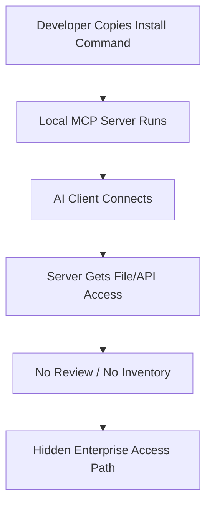
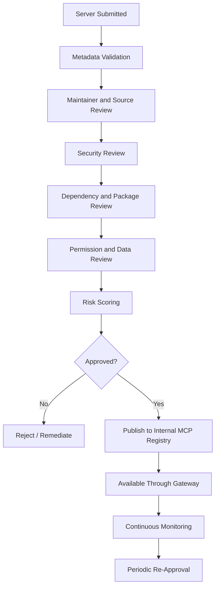
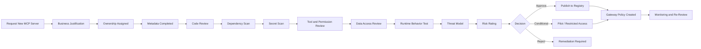
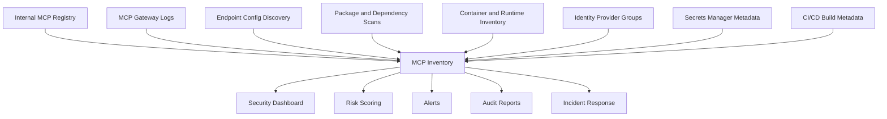
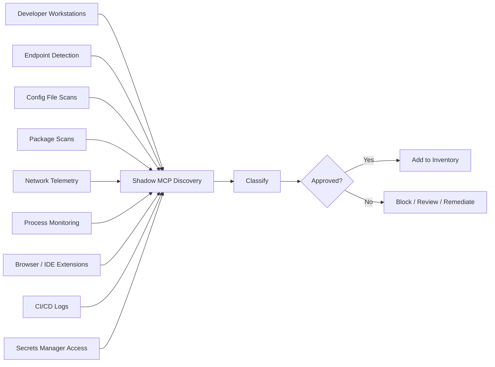
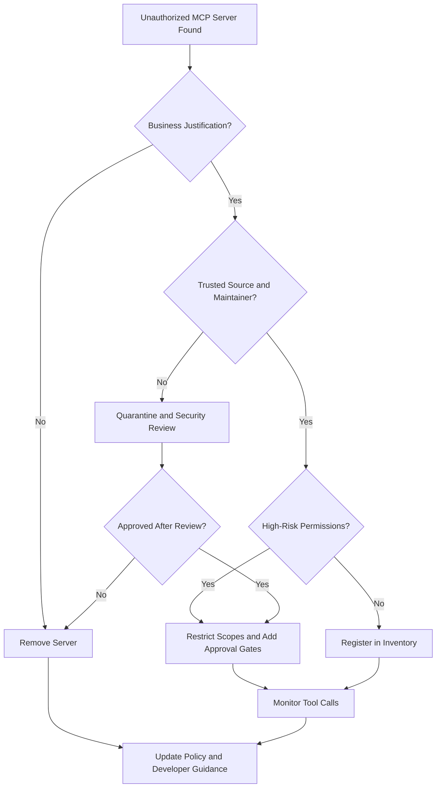

# 3.14 Enterprise Governance (`GOV`)

[← Chapter 3 overview](<3. MCP Threats and Attack Patterns.md>) · [Test case format](test-case-format.md)

## Overview

Governance tests evaluate **organizational controls**: server inventory, approved registries, policy enforcement on hosts, exception handling, and compliance evidence. The registry, approval workflow, inventory, shadow-MCP discovery, and operating model are in [Enterprise governance controls](#enterprise-governance-controls).

## Why this category matters

Enterprises cannot secure MCP by ad hoc installs. Fleet visibility and policy gates determine which tests in sections 3.1–3.19 are even reachable in production.

## Scope

CMDB/inventory accuracy, allow/block lists, MDM or EDR policy, exception workflows, audit evidence for regulators.

## When to prioritize

Primary for **enterprise platform** teams; complements SUPP and CONF.

## Related categories

[SUPP](3.13-supply-chain.md), [AUTHZ](3.04-authorization-permission.md), [GW](3.16-gateway-egress.md), [LOG](3.12-logging-detection.md), [PRVC](3.19-privacy-retention.md)

## Common test chains

GOV-02 + SUPP-04; GOV-03 + CONF-02 (policy vs actual exposure).

## Threats and attack patterns

Governance failures show up in the published record as servers nobody had approved, tokens that were broader than the task, and installs that survived removal from a registry. The incidents themselves are written up under supply chain, authorization, and deployment. This section states the control those write-ups say was missing.

### Unapproved servers stayed in developer configs

Snyk’s `postmark-mcp` timeline is a governance exhibit. The package was first published on 15 September 2025, malicious behavior is reported from about version `1.0.16`, and on 25 September 2025 it was gone from npm. Snyk’s persistence note:

> “Even if the package is later removed from npm, installed copies keep running until explicitly uninstalled, and configurations are updated.”
>
> — Snyk, [Malicious MCP Server on npm postmark-mcp Harvests Emails](https://snyk.io/blog/malicious-mcp-server-on-npm-postmark-mcp-harvests-emails/)

JFrog’s 19 October 2025 report adds three PyPI names (`mcp-runcmd-server`, `mcp-runcommand-server`, `mcp-runcommand-server2`) that were MCP servers with a reverse shell and about 1.6K combined downloads ([JFrog](https://research.jfrog.com/post/3-malicious-mcps-pypi-reverse-shell/)). Checkmarx’s 1 October 2025 report adds `@lanyer640/mcp-runcommand-server`, removed from public npm and still a risk in private caches ([Checkmarx Zero](https://checkmarx.com/zero-post/npm-malware-alert-lanyer640-mcp-runcommand-server-with-reverse-shell/)). An approved-registry policy that does not scan already-installed commands will miss all three.

Invariant’s 1 April 2025 conclusion is the policy statement that matches `MCPSTG-GOV-02`: users should be cautious with third-party MCP servers, “especially when servers in the same context handle sensitive data or credentials” ([Tool Poisoning Attacks](https://invariantlabs.ai/blog/mcp-security-notification-tool-poisoning-attacks)). Their MCP-Scan announcement (11 April 2025) is a concrete inventory method: scan installed servers and hash tool descriptions ([Introducing MCP-Scan](https://invariantlabs.ai/blog/introducing-mcp-scan)).

**Tests:** `MCPSTG-GOV-01`, `MCPSTG-GOV-02`. Evidence is the list of configured servers compared with the approved list, including version and command line, plus servers listening on the network that are not in any desktop config. Those listeners are the `excel-mcp-server`, MySQL MCP, and `mcp-atlassian` deployment pattern in [3.2](3.02-configuration-deployment.md).

### Policy said “least privilege”; the token could read every repository

The GitHub MCP demonstration (Invariant Labs; dated 26 May 2025 by [The Vulnerable MCP Project](https://vulnerablemcp.info/vuln/github-mcp-exploit.html)) used a normal maintainer setup: one token for the official GitHub MCP server that could read the public repository where a stranger can file an issue and the private repositories that hold the data. Willison’s 16 June 2025 post says that once users mix tools themselves, the vendor of each tool cannot prevent the combination ([The lethal trifecta](https://simonwillison.net/2025/jun/16/the-lethal-trifecta/)).

The MCP security document’s scope section is the enterprise rule for the same gap. If `scopes_supported` lists every scope and the client requests them all, the issued token can call high-risk tools without a later elevation prompt. The document’s examples of those scopes are `files:*`, `db:*`, and `admin:*`. It also says revocation of that one token interrupts every workflow, which is why teams leave it in place.

**Tests:** `MCPSTG-GOV-03`, `MCPSTG-GOV-04`. An exception record should name the scope, the repositories or systems it covers, and the expiry. A standing “developers may install MCP servers” exception without a package allowlist does not match the incidents above.

### Consent and audit evidence the specification already requires

The security best-practices document requires an MCP proxy’s consent page to identify the client, display the third-party scopes, and show the registered redirect URI. It requires per-client consent stored server-side, and it says the consent cookie must not be set before the user approves that page. Token passthrough is forbidden in part because it destroys attribution: downstream logs show a different identity than the MCP client that made the call ([Security Best Practices](https://modelcontextprotocol.io/docs/2026-07-28/tutorials/security/security_best_practices), 28 July 2026 docs).

**Tests:** `MCPSTG-GOV-05`. Compliance evidence for an MCP assessment is the inventory export, the allowlist decision, the consent record (client id, scopes, redirect URI, time), and a tool-call log that still identifies the MCP client after the upstream API is called. Reconstruction technique is in [3.12](3.12-logging-detection.md).

### Canonical attack patterns

The write-ups below moved here from the threats chapter. Each one names the abuse, a lab-safe example, the impact, red flags, and defensive checks. Published cases earlier in this section remain the sourced record. Use both when you choose tests.

### Shadow MCP Servers

**Tests:** `MCPSTG-GOV-01`, `MCPSTG-GOV-02`, `MCPSTG-INFO-01`, `MCPSTG-CONF-01`.

Shadow MCP servers are unauthorized, unmanaged, or unknown MCP servers connected to AI clients. They may be installed by developers for convenience, added by browser extensions or IDE plugins, pulled from public repositories, or configured through copied setup commands.

Shadow MCP is the new shadow IT, but with direct access to context, tools, files, and credentials.

#### Where shadow MCP servers appear

* Developer laptops.
* AI IDEs and coding assistants.
* Local automation scripts.
* Browser-based AI clients.
* Internal hackathon projects.
* Personal productivity setups.
* CI/CD experiments.
* Shared team configuration files.

#### Why they are risky

* They may run with the same privileges as the user.
* They may access local files, SSH keys, cloud credentials, or source code.
* They may not be patched or monitored.
* They may expose HTTP services on localhost.
* They may be reachable by other local processes.
* They may silently update or change tool definitions.
* Security teams may not know they exist.

#### Shadow MCP lifecycle



#### Impact

* Unreviewed tools access sensitive data.
* Local compromise becomes enterprise compromise.
* Secrets leak through logs, tool outputs, or external calls.
* Incident responders lack inventory and telemetry.
* Developers unknowingly connect personal tools to corporate workflows.

#### Red flags

* MCP server configs outside managed repositories.
* One-click installs that execute package-manager commands.
* Servers installed from personal GitHub repos without review.
* Local servers exposing HTTP endpoints without authentication.
* Tools requesting broad filesystem or network access.
* No central inventory of installed MCP servers.

#### Defensive guidance

* Maintain an approved MCP server registry.
* Inventory MCP server configurations across developer endpoints.
* Require review for local server install commands and startup scripts.
* Prefer signed packages and pinned versions.
* Run local servers in sandboxes with restricted filesystem and network access.
* Block or warn on risky startup commands.
* Require explicit consent before connecting a new local server.
* Monitor for unknown MCP processes, listening ports, and config changes.
* Provide secure, approved alternatives so developers do not need risky shortcuts.

### Defender’s Checklist for MCP Attack Patterns

### Tool and server governance

* Maintain an inventory of approved MCP servers.
* Namespace tools by server identity.
* Review tool definitions, schemas, annotations, examples, resources, and prompt templates.
* Hash the approved tool list and re-prompt when it changes.
* Pin tool and server versions. Re-check advisory floors before you freeze them.
* Require review for new tools, changed tool metadata, and changed launch commands.
* Detect duplicate, lookalike, homoglyph, and overlapping tool names.
* Show the full install command before it runs. Prefer `stdio` for local servers.

## Enterprise governance controls

MCP adoption usually starts innocently: one developer connects an AI coding assistant to a local filesystem server, another team adds a GitHub server, a data team exposes a database connector, and suddenly the organization has AI systems that can read files, call APIs, update tickets, query production data, and trigger workflows.

That is the moment MCP stops being “just another integration” and becomes enterprise infrastructure.

This section explains how organizations can govern MCP at scale using gateways, registries, approval workflows, role-based access control, inventory management, and shadow MCP discovery. The goal is not to slow innovation down. The goal is to make MCP usable without turning every AI client into a tiny unsupervised intern with root access and excellent confidence.

Enterprise MCP governance should answer six practical questions:

1. **Which MCP servers are allowed?**
2. **Who approved them?**
3. **Which users, teams, agents, and clients can access them?**
4. **What tools, resources, prompts, and data do they expose?**
5. **What actions are being performed through them?**
6. **How do we detect unmanaged, risky, or malicious MCP usage?**

At enterprise scale, direct client-to-server connections are hard to govern. A gateway and registry model gives security, platform, and engineering teams a centralized control layer for routing, identity, policy, observability, approvals, and lifecycle management.

Public registry limits — what a name actually proves — are in [3.13 Supply Chain](3.13-supply-chain.md#the-mcp-registry-and-what-a-name-actually-proves). Who may call a tool is in [3.4 Authorization](3.04-authorization-permission.md#role-based-access-control). The gateway that enforces those decisions is in [3.16](3.16-gateway-egress.md#mcp-gateway-architecture). Detection and the SOC review are in [3.12](3.12-logging-detection.md#soc-and-incident-readiness-review).

## MCP Registry Governance

An MCP registry helps users and clients discover MCP servers. In an enterprise, discovery is not only a convenience feature; it is a security boundary.

A registry answers:

* Which MCP servers exist?
* Who maintains them?
* Where is the source code?
* Which package or container provides the server?
* Which tools, resources, and prompts does it expose?
* Which permissions does it require?
* Which version is approved?
* Which business unit owns it?
* Which users and clients may connect to it?
* What is its risk score?

A public registry can help the ecosystem discover MCP servers. An enterprise registry should go further: it should function as an **approved catalog** of MCP servers that have passed security, legal, operational, and business review.

### Registry governance model



### Trusted registry principles

An enterprise MCP registry should be treated like an internal app store for AI-accessible capabilities.

Trusted registry governance should include:

* **Approved server lists** for production use.
* **Risk scores** for every server and tool.
* **Verified maintainers** for internal and external servers.
* **Known source locations**, such as GitHub repository, package registry, container image, or internal build system.
* **Provenance metadata**, including commit hash, package digest, container digest, build pipeline, and signer identity where available.
* **Security status**, including last scan, known vulnerabilities, dependency risk, and fix status.
* **Data classification**, including whether the server can access internal, confidential, regulated, customer, or production data.
* **Permission declarations**, including read, write, delete, execute, network, filesystem, database, identity, and deployment capabilities.
* **Change history**, including metadata drift, tool description changes, schema changes, and permission changes.
* **Owner accountability**, including technical owner, business owner, and security reviewer.

### Suggested registry metadata fields

Each MCP server entry should include structured metadata.

| Field                    | Description                                              | Example                                  |
| ------------------------ | -------------------------------------------------------- | ---------------------------------------- |
| Server Name              | Canonical approved name                                  | `internal-github-mcp`                    |
| Display Name             | Human-readable name                                      | `GitHub MCP Server`                      |
| Unique Identifier        | Stable ID to avoid name confusion                        | `com.company.mcp.github`                 |
| Source Repository        | Where the code is maintained                             | Internal Git repository                  |
| Package Source           | npm, PyPI, container registry, binary, internal artifact | Internal container registry              |
| Version                  | Approved version                                         | `1.4.2`                                  |
| Build Digest             | Immutable build or image digest                          | Container SHA digest                     |
| Maintainer               | Person, team, or vendor responsible                      | Developer Platform Team                  |
| Business Owner           | Accountable business unit                                | Engineering Productivity                 |
| Security Owner           | Security reviewer or team                                | AppSec AI Security Team                  |
| Trust Tier               | Public, internal, production, regulated                  | Internal Development                     |
| Tools Exposed            | Tool list and risk labels                                | `list_repos`, `create_issue`, `merge_pr` |
| Resources Exposed        | Files, URLs, data stores, documents, APIs                | GitHub repositories                      |
| Prompts Exposed          | Reusable prompt templates                                | `generate_release_notes`                 |
| Permissions Required     | Required scopes and credentials                          | repo read, issue write                   |
| Data Classification      | Sensitivity of accessed data                             | Source code, internal metadata           |
| Network Access           | External or internal endpoints reached                   | GitHub Enterprise API                    |
| Authentication Method    | User delegated, service account, workload identity       | User delegated OAuth                     |
| Approval Status          | Approved, conditional, blocked, deprecated               | Approved                                 |
| Approved Clients         | Clients allowed to connect                               | Approved IDE clients only                |
| Approved User Groups     | Teams allowed to use                                     | Engineering teams                        |
| Risk Score               | Numeric or tier-based risk rating                        | Medium                                   |
| Last Security Review     | Date of latest security review                           | 2026-04-15                               |
| Last Activity            | Last observed usage                                      | 2026-05-01                               |
| Expiration / Review Date | When re-approval is required                             | 2026-07-15                               |

### Server risk scoring

Registry entries should have risk scores that influence gateway behavior.

Risk factors may include:

* Whether the server is internally developed or community-maintained.
* Whether the maintainer identity is verified.
* Whether the source code is available and reviewed.
* Whether the server requires sensitive credentials.
* Whether it exposes write, delete, execute, deploy, payment, messaging, or identity-changing tools.
* Whether it accesses sensitive data.
* Whether it runs locally on developer workstations or remotely in managed infrastructure.
* Whether dependencies are pinned, scanned, and maintained.
* Whether package provenance and signing are available.
* Whether tool descriptions and schemas have changed since approval.
* Whether the server has known vulnerabilities or advisories.
* Whether runtime telemetry shows unusual usage.

Example risk score model:

| Risk Tier | Description                                                                              | Gateway Behavior                                                                |
| --------- | ---------------------------------------------------------------------------------------- | ------------------------------------------------------------------------------- |
| Low       | Read-only, internal, reviewed, minimal data access                                       | Allow for approved groups                                                       |
| Medium    | Limited write capability or access to internal data                                      | Allow with logging and scoped permissions                                       |
| High      | Sensitive data, broad write actions, external dependencies, or privileged systems        | Require approvals, DLP, step-up auth, tighter monitoring                        |
| Critical  | Production-changing, destructive, identity-changing, financial, or regulated data access | Restricted access, human-in-the-loop, separation of duties, break-glass process |
| Blocked   | Untrusted, vulnerable, malicious, unsupported, or unknown provenance                     | Deny by gateway and client policy                                               |

### Internal publishing process

A server should not appear in the internal enterprise registry just because someone installed it once.

Recommended publishing stages:

1. **Submitted**: Server is proposed by a team or individual.
2. **Validated**: Required metadata is complete.
3. **Security Review**: Code, dependencies, permissions, data access, and runtime behavior are reviewed.
4. **Conditional Approval**: Server may be used in limited environments or by a pilot group.
5. **Approved**: Server is available through the gateway for defined groups.
6. **Deprecated**: Server is still visible but migration is required.
7. **Blocked**: Server is denied by policy due to risk, vulnerability, malicious behavior, or lack of ownership.
8. **Retired**: Server is removed from active use.

### Registry governance anti-patterns

Avoid:

* Treating registry presence as automatic trust.
* Allowing duplicate or lookalike server names without unique identifiers.
* Publishing servers without maintainer verification.
* Listing servers without tool-level metadata.
* Ignoring package provenance and dependency risk.
* Allowing stale, abandoned, or unowned servers to remain approved.
* Failing to notify users when tool descriptions, permissions, or versions change.
* Not distinguishing between discovery and approval.

### Security outcome

A governed MCP registry gives organizations a trusted catalog of AI-accessible capabilities. It reduces typosquatting, name confusion, unreviewed server adoption, and unmanaged tool exposure.

### Registry review

| Check | What to verify | Why it matters | Evidence to collect | Good examples | Common gaps |
| --- | --- | --- | --- | --- | --- |
| Approved registry exists | Define where approved MCP servers come from. | Reduces random package installation. | Registry URL, policy. | Internal MCP registry with reviewed entries. | Developers install from random source repos. |
| Publishing rules are defined | Internal servers must meet metadata and review requirements. | Prevents unsafe internal sprawl. | Publishing checklist. | Owner, purpose, scopes, risk, and evidence required. | Anyone can publish a server. |
| Registry metadata includes risk | Users need security context before install. | Risk visibility supports good decisions. | Registry entry. | “High risk: can modify source repositories.” | Entry only has a name and an install command. |
| Deprecated servers are removable | Security can block vulnerable or malicious servers. | Enables fast containment. | Admin controls, registry logs. | Emergency denylist. | An old vulnerable server remains discoverable. |
| Registry monitors drift | Tool definitions, scopes, maintainers, and versions are tracked. | Servers can change after approval. | Diff reports. | Alert when a new tool appears. | Nobody notices a new `exec_command` tool. |

Minimum acceptance criteria:

* Enterprises prefer approved registries or allowlists over unmanaged public server discovery.

---

## Server Approval Workflow

Every new MCP server should go through an approval workflow before it is used in production or connected to sensitive data.

The approval process should answer a simple question:

**“Is this MCP server safe enough for the users, tools, data, and systems it will touch?”**

Approval should not be a rubber stamp. MCP servers are executable integrations that may expose tools to AI systems. A server can leak source code, exfiltrate credentials, modify tickets, update cloud resources, execute commands, access databases, or manipulate business workflows.

### Recommended approval workflow



### Approval checklist

#### Business justification

The requester should explain:

* What problem the server solves.
* Which teams need it.
* Which clients or AI hosts will use it.
* Which workflows it supports.
* Whether the same capability already exists in an approved server.
* What happens if the server is unavailable or disabled.

Security question: **Is this a real business need or just “the AI agent wanted more toys”?**

#### Ownership

Every server must have clear owners.

Required ownership roles:

| Role              | Responsibility                                                  |
| ----------------- | --------------------------------------------------------------- |
| Requester         | Submits the request and use case                                |
| Technical Owner   | Maintains the server, fixes bugs, updates dependencies          |
| Business Owner    | Accepts business risk and approves usage                        |
| Security Reviewer | Reviews code, permissions, data access, and risk                |
| Operations Owner  | Handles deployment, monitoring, incident response, and rollback |

No owner means no approval. Orphaned MCP servers are future incident reports with better branding.

#### Code review

Code review should check for:

* Unsafe command execution.
* Path traversal risks.
* Server-side request forgery.
* Insecure deserialization.
* Hardcoded secrets.
* Overly broad filesystem access.
* Unsafe environment variable exposure.
* Weak authentication or authorization logic.
* Missing tenant isolation.
* Dangerous default settings.
* Hidden prompts or instructions embedded in tool behavior.
* Unexpected external network calls.

For closed-source third-party servers, the review should evaluate vendor security posture, documentation, binary provenance, package reputation, and runtime sandboxing options.

#### Dependency and package scan

Dependency review should include:

* Direct dependencies.
* Transitive dependencies.
* Known vulnerabilities.
* Typosquatting or name confusion risk.
* Dependency confusion risk.
* Abandoned packages.
* Suspicious maintainers or sudden ownership changes.
* Unpinned versions.
* Install scripts and post-install behavior.
* Package integrity and signing where available.

#### Secrets review

MCP servers often need credentials to access APIs, SaaS systems, databases, cloud platforms, or internal services.

Review should verify:

* No secrets are hardcoded in code, config, examples, logs, or documentation.
* Secrets are stored in approved secret managers.
* Credentials are scoped to least privilege.
* User-delegated authorization is used where appropriate.
* Service accounts are not shared across unrelated teams.
* Tokens have expiration and rotation processes.
* Secrets are never returned to the model as tool output.

#### Tool and permission review

Each exposed tool should be reviewed separately.

For every tool, capture:

* Tool name.
* Description.
* Input schema.
* Output schema.
* Required permission.
* Read/write/delete/execute classification.
* Data touched.
* Side effects.
* Risk tier.
* Approval requirement.
* Logging requirement.

Example tool review table:

| Tool                 | Capability                           | Risk     | Required Control                             |
| -------------------- | ------------------------------------ | -------- | -------------------------------------------- |
| `list_repos`         | Lists repositories available to user | Low      | Allow for engineering group                  |
| `read_file`          | Reads repository file content        | Medium   | Restrict to approved repos                   |
| `create_issue`       | Creates GitHub issue                 | Medium   | Log action and user identity                 |
| `merge_pull_request` | Merges code                          | High     | Require human confirmation and branch policy |
| `delete_repository`  | Deletes repository                   | Critical | Deny through MCP gateway                     |

#### Data access review

Data review should identify:

* What data the server can access.
* Whether the server can access customer data.
* Whether the server can access source code.
* Whether the server can access production systems.
* Whether the server can access regulated data.
* Whether the server can combine data across systems.
* Whether data can leave the organization.
* Whether outputs may expose secrets or sensitive data to the model.

Data access should be minimized by default. The fact that an AI client can ask for something does not mean the MCP server should be able to fetch it.

#### Runtime behavior test

Before approval, test the server in a controlled environment.

Test cases should include:

* Normal expected tool calls.
* Invalid input handling.
* Malicious input handling.
* Prompt injection in tool inputs.
* Prompt injection in tool outputs.
* Excessive request volume.
* Unauthorized resource access.
* Dangerous file paths.
* Unexpected network calls.
* Credential exposure attempts.
* Tool description manipulation.
* Schema poisoning attempts.

#### Threat model

The approval process should include a lightweight threat model.

Minimum threat model questions:

* What can the server read?
* What can the server change?
* What can the server delete?
* What can the server execute?
* What credentials does it use?
* What happens if the server is malicious?
* What happens if the client is compromised?
* What happens if tool output contains prompt injection?
* What happens if a dependency is compromised?
* What logs exist for investigation?
* How can the server be disabled quickly?

#### Approval decision

Possible decisions:

| Decision                   | Meaning                                                                    |
| -------------------------- | -------------------------------------------------------------------------- |
| Approved                   | Server may be published to the internal registry with defined policies     |
| Conditionally Approved     | Server may be used by limited users, clients, environments, or data scopes |
| Approved for Read-Only Use | Write, delete, execute, or privileged tools are disabled                   |
| Requires Remediation       | Issues must be fixed before approval                                       |
| Rejected                   | Risk exceeds acceptable threshold                                          |
| Blocked                    | Server is explicitly denied by gateway/client policy                       |

### Security outcome

A server approval workflow makes MCP adoption repeatable and defensible. It creates a consistent path for innovation while ensuring servers are reviewed before they become invisible bridges into sensitive systems.

---


## Enterprise MCP Inventory

Organizations cannot govern what they cannot see.

An enterprise MCP inventory is a living record of MCP clients, servers, tools, resources, prompts, users, permissions, versions, owners, credentials, data access, and activity. It should combine registry metadata, gateway telemetry, endpoint discovery, package scans, and configuration reviews.

The inventory should help answer:

* Which MCP servers are installed?
* Which ones are approved?
* Which ones are blocked?
* Which clients are using MCP?
* Which users and teams are invoking tools?
* Which tools have write, delete, execute, or production capabilities?
* Which servers access sensitive data?
* Which credentials are used?
* Which versions are vulnerable or outdated?
* Which servers are inactive, orphaned, or abandoned?
* Which tool descriptions or schemas changed recently?
* Which MCP activity looks unusual?

### Inventory architecture



### Inventory fields

Recommended inventory fields include:

| Category          | Fields to Track                                                                         |
| ----------------- | --------------------------------------------------------------------------------------- |
| Server Identity   | Name, unique ID, description, owner, maintainer, source repository, package source      |
| Versioning        | Current version, approved version, deployed version, build digest, last update          |
| Approval          | Approval status, approver, review date, expiry date, risk rating                        |
| Client Usage      | Connected clients, host applications, IDEs, agent platforms, automation runners         |
| User Usage        | Users, teams, service accounts, roles, last activity                                    |
| Tool Metadata     | Tool names, descriptions, schemas, risk labels, side effects                            |
| Resource Metadata | Files, databases, APIs, SaaS systems, knowledge bases, data stores exposed              |
| Prompt Metadata   | Prompt templates, intended usage, risk labels, owner                                    |
| Permissions       | OAuth scopes, API permissions, filesystem paths, network destinations, database roles   |
| Data Access       | Data classification, customer data, regulated data, production data, source code access |
| Secrets           | Secret manager reference, rotation status, expiration, owner, scope                     |
| Runtime           | Deployment location, host, container image, process, network path, sandbox status       |
| Security          | Vulnerability status, dependency health, secret scan status, policy violations          |
| Telemetry         | Tool calls, call volume, denied requests, approvals, anomalies, errors                  |
| Lifecycle         | Active, pilot, deprecated, blocked, retired                                             |

### Example inventory entry

```yaml
server_id: com.company.mcp.github
name: internal-github-mcp
display_name: GitHub MCP Server
owner_team: Developer Platform
business_owner: Engineering Productivity
security_owner: AppSec AI Security
source_repository: internal/git/mcp-github-server
package_source: internal-container-registry
approved_version: 1.4.2
deployed_version: 1.4.2
build_digest: sha256:exampledigest
approval_status: approved
risk_tier: high
trust_zone: internal_development
approved_clients:
  - approved-ide-client
  - internal-agent-platform
approved_groups:
  - engineering-fulltime
  - sre-team
tools:
  - name: list_repositories
    risk: low
    capability: read_only
  - name: read_file
    risk: medium
    capability: read_only
    data_classification: source_code
  - name: create_pull_request
    risk: medium
    capability: write_capable
  - name: merge_pull_request
    risk: high
    capability: write_capable
    approval_required: true
  - name: delete_repository
    risk: critical
    capability: delete_capable
    gateway_status: blocked
data_access:
  - source_code
  - repository_metadata
permissions:
  - repo:read
  - pull_request:write
secrets:
  storage: enterprise_secret_manager
  rotation_days: 60
last_security_review: 2026-04-15
next_review_due: 2026-07-15
last_activity: 2026-05-01T10:30:00Z
monitoring:
  gateway_logging: enabled
  dlp_inspection: enabled
  anomaly_detection: enabled
```

### Inventory dashboards

Enterprise dashboards should show:

* Total MCP servers discovered.
* Approved vs unapproved servers.
* Servers by risk tier.
* Servers by business owner.
* Servers with sensitive data access.
* Servers with production access.
* Servers with write/delete/execute tools.
* Servers with known vulnerabilities.
* Servers with stale approvals.
* Servers with inactive owners.
* Servers using deprecated versions.
* Most invoked tools.
* Most denied tools.
* Highest-risk users, clients, and workflows.
* Recent tool description or schema changes.

### Inventory alerts

Create alerts for:

* New unapproved MCP server discovered.
* Approved server version changed without review.
* Tool description changed after approval.
* Tool schema changed after approval.
* New write/delete/execute tool added.
* New sensitive data access detected.
* Server starts contacting unexpected domains.
* Server uses a vulnerable dependency.
* Server uses hardcoded or exposed credentials.
* Disabled server becomes active again.
* High-risk tool called outside normal hours.
* Unusual call volume from one user, client, or agent.
* Tool output contains secrets or regulated data.

### Inventory ownership model

A useful inventory must stay fresh. Assign ownership:

| Owner                | Responsibility                                |
| -------------------- | --------------------------------------------- |
| Platform Team        | Maintains registry and gateway integration    |
| AppSec Team          | Defines review criteria and risk scoring      |
| SOC / Detection Team | Monitors runtime activity and alerts          |
| GRC Team             | Maps MCP inventory to compliance requirements |
| Business Owners      | Approve business use and data access          |
| Engineering Owners   | Patch, update, and maintain servers           |
| Identity Team        | Manages RBAC groups and access reviews        |

### Security outcome

An MCP inventory gives the organization a map of its AI-accessible attack surface. It supports governance, monitoring, incident response, compliance, and lifecycle management.

### Inventory review

| Check | What to verify | Why it matters | Evidence to collect | Good examples | Common gaps |
| --- | --- | --- | --- | --- | --- |
| Inventory all MCP clients | Know where MCP is being used. | Unknown clients create blind spots. | Endpoint inventory, app catalog. | IDE, desktop assistant, internal assistant, and CI agent listed. | Only production systems inventoried. Developer IDEs ignored. |
| Inventory all MCP servers | Track server name, source, version, owner, permissions, and environment. | Enables review, patching, and incident response. | MCP registry, CMDB. | Central list with risk rating. | Servers live only in local config files. |
| Inventory exposed tools | Know what actions agents can perform. | The tool list is the real permission surface. | Server metadata, registry export. | `read_docs`, `create_ticket`, `deploy_service` mapped. | Only server names are tracked. |
| Inventory credentials and scopes | Know what each server can access. | Credentials define blast radius. | OAuth grants, vault paths, service account roles. | Source-control MCP has a read-only repo scope. | Server uses a developer’s personal admin token. |
| Assign owners | Every server, client, and policy has an accountable owner. | Ownership drives remediation. | Owner fields, escalation contacts. | Product owner, technical maintainer, and security reviewer. | “Ask in chat if something breaks.” |

Minimum acceptance criteria:

* The enterprise has a searchable inventory of MCP clients, servers, tools, owners, versions, credentials, and risk ratings.

---

## Shadow MCP Discovery

The attack pattern [Shadow MCP Servers](#shadow-mcp-servers) is the risk. This section is how to find it.

Shadow MCP refers to MCP clients, servers, tools, configurations, or workflows that are used without central approval or visibility.

It can happen when:

* Developers install community MCP servers locally.
* AI coding tools auto-discover local server configs.
* Teams run experimental MCP servers for internal workflows.
* Contractors bring their own AI tools.
* Servers are pulled from public package registries without review.
* Old proof-of-concept servers remain active.
* Local config files contain broad filesystem or credential access.
* An MCP server is bundled into another developer tool.

Shadow MCP is risky because it bypasses the gateway, registry, approval workflow, monitoring, and enterprise policy. It is the AI-era version of shadow IT, except the shadow system may be able to read source code, call internal APIs, and take action through an agent.

### Shadow MCP discovery sources



### What to look for

Shadow MCP discovery should look for:

* Local MCP configuration files.
* Unknown MCP server processes.
* MCP server packages installed through npm, PyPI, Docker, Homebrew, or other package managers.
* MCP-related commands in shell history or scripts.
* IDE extensions or AI clients configured with local MCP servers.
* Local servers listening on unexpected ports.
* Processes with access to sensitive directories.
* Servers using environment variables containing credentials.
* Network connections from MCP processes to unknown domains.
* Containers running MCP servers outside approved environments.
* CI/CD jobs launching MCP servers.
* Unapproved clients connecting to approved servers.
* Approved clients connecting to unapproved servers.

### Endpoint discovery

Endpoint detection can identify local MCP usage by looking for:

* Known MCP client and server process names.
* Command-line patterns used to start MCP servers.
* Local config file paths used by popular AI clients.
* Package names containing `mcp`, `model-context-protocol`, or related server naming conventions.
* Local ports opened by MCP servers.
* Parent-child process relationships between AI clients and MCP server processes.
* Access to sensitive files such as `.env`, SSH keys, cloud credentials, kubeconfig files, Git credentials, and source code directories.

### Config discovery

MCP clients commonly use configuration files to define server commands, arguments, environment variables, and transport settings. These files should be reviewed for:

* Unapproved servers.
* Broad filesystem paths.
* Environment variables containing secrets.
* Unsafe command arguments.
* Local servers launched from unknown paths.
* Packages installed from public registries.
* Servers using `latest` instead of pinned versions.
* Duplicate or confusing server names.
* Disabled security prompts or auto-approval settings.

Example risky config pattern:

```json
{
  "mcpServers": {
    "filesystem": {
      "command": "npx",
      "args": ["-y", "some-random-filesystem-mcp", "/"],
      "env": {
        "GITHUB_TOKEN": "hardcoded-token-here"
      }
    }
  }
}
```

Why this is risky:

* Installs a server dynamically from a package registry.
* Uses an unreviewed package.
* Grants access to the root filesystem.
* Hardcodes a credential.
* May bypass enterprise gateway logging and policy.

### Package scanning

Package scans should detect:

* MCP server packages installed locally.
* Lookalike or typosquatted package names.
* Packages with install scripts.
* Packages with suspicious maintainers.
* Packages with recent ownership changes.
* Packages pulling remote code at runtime.
* Packages with vulnerable dependencies.
* Packages that are not present in the approved registry.

Scan package sources such as:

* npm
* PyPI
* Docker images
* GitHub releases
* Homebrew formulas
* Internal artifact repositories
* Language-specific lockfiles

### Network monitoring

Network telemetry can identify MCP-like behavior by looking for:

* AI clients connecting to unknown local or remote MCP endpoints.
* MCP servers connecting to unexpected external services.
* Repeated JSON-RPC-like traffic patterns.
* Connections to public package registries during server startup.
* Localhost services used by AI clients.
* Connections from developer workstations to internal APIs through unknown processes.

Network monitoring should not rely only on protocol signatures. Some MCP servers may use standard transports or be wrapped in custom launchers. Combine network signals with endpoint, package, and config discovery.

### Policy enforcement for shadow MCP

When shadow MCP is discovered, organizations should have clear actions:

| Discovery                                    | Recommended Action                                     |
| -------------------------------------------- | ------------------------------------------------------ |
| Approved server running approved version     | Add to inventory if missing                            |
| Approved server running outdated version     | Require update or block old version                    |
| Unapproved server with low risk              | Route through approval workflow                        |
| Unapproved server with sensitive data access | Disable and investigate                                |
| Server with hardcoded secrets                | Revoke secrets, rotate credentials, remediate config   |
| Server with malicious behavior               | Isolate endpoint, preserve evidence, incident response |
| Client bypassing gateway                     | Reconfigure client and enforce gateway-only policy     |
| Unknown public package                       | Block pending package and maintainer review            |

### Developer-friendly remediation

Shadow MCP discovery should not only punish users. Many teams use unapproved MCP because they need speed, better tools, or clearer guidance.

Provide:

* A self-service request path for new MCP servers.
* Clear “approved alternatives” for common use cases.
* Templates for secure MCP configuration.
* Example least-privilege server configs.
* Developer education on MCP risks.
* Local scanning tools before installation.
* Fast-track approval for low-risk read-only servers.
* A safe sandbox for experimentation.

Good governance reduces shadow MCP by making the secure path easier than the risky path.

### Shadow MCP detection checklist

Use this checklist during enterprise rollout:

* [ ] Search developer endpoints for MCP config files.
* [ ] Scan installed packages for MCP server packages.
* [ ] Review AI client configuration across managed devices.
* [ ] Detect local MCP server processes.
* [ ] Monitor local ports used by AI clients and MCP servers.
* [ ] Review environment variables exposed to MCP servers.
* [ ] Scan for hardcoded tokens in MCP configs.
* [ ] Compare discovered servers with approved registry entries.
* [ ] Identify servers with broad filesystem access.
* [ ] Identify servers with production credentials.
* [ ] Identify clients bypassing the MCP gateway.
* [ ] Add approved findings to inventory.
* [ ] Disable or quarantine high-risk unknown servers.
* [ ] Create developer-friendly remediation guidance.

### Security outcome

Shadow MCP discovery helps organizations find unmanaged AI tool integrations before attackers, auditors, or production incidents do. It turns unknown MCP usage into inventory, policy, and reviewable risk.

---

## Shadow MCP Discovery Incident

Discovery of unmanaged servers is in [Shadow MCP Discovery](#shadow-mcp-discovery). This is the response once one is found. The shared incident record is in [3.12](3.12-logging-detection.md#during-an-incident).

This subsection covers discovery of unauthorized MCP servers, clients, configurations, or agent workflows. Shadow MCP often begins with good intentions: a developer installs a local server, connects it to an IDE, adds a helpful tool, and suddenly the AI assistant has access to source code, cloud credentials, local files, tickets, and internal APIs without formal review.

Shadow MCP can appear as:

* Unapproved MCP servers on developer workstations.
* Local servers configured in IDEs or desktop assistants.
* Personal tokens used for enterprise workflows.
* Unreviewed open-source MCP packages.
* Internal teams publishing unofficial MCP servers.
* Agent workflows using MCP outside approved gateways.
* Hardcoded secrets in local MCP configuration files.

### Immediate Response

1. Identify the server, owner, host, tools, permissions, and business purpose.
2. Determine whether the server is actively used or exposed to sensitive systems.
3. Disable or quarantine the server if it has high-risk permissions or unknown provenance.
4. Preserve configuration, package metadata, tool definitions, and usage logs.
5. Review tokens, environment variables, and credentials available to the server.
6. Determine whether data was accessed, modified, or transmitted externally.
7. Decide whether to formally approve, restrict, replace, or remove the server.

### Shadow MCP Inventory Checklist

For each discovered server, record:

* Server name and version.
* Hostname, user, team, and business owner.
* Installation source and maintainer.
* Client or IDE using the server.
* Transport type.
* Tools, resources, prompts, and exposed capabilities.
* Runtime permissions and local file access.
* Credentials available to the process.
* Network destinations contacted.
* Last used timestamp and frequency of use.
* Data sources accessed.
* Approval status.
* Risk rating.
* Decision: approve, restrict, monitor, replace, or remove.

### Endpoint Investigation

Check common MCP locations and artifacts, such as:

```text
Developer Workstations
├── IDE configuration
├── Desktop assistant configuration
├── MCP client config files
├── Local npm/pip/uv packages
├── Docker containers
├── Shell history
├── Environment variables
├── .env files
├── Cloud CLI profiles
├── Git credentials
└── Local server processes
```

Also review:

* Running processes and listening ports.
* Package manager install history.
* Recently modified configuration files.
* Startup scripts and launch agents.
* Container runtime history.
* Browser extension or local app integrations.
* MCP gateway bypass attempts.

### Risk Assessment Questions

* Does the server access production systems?
* Does it use personal credentials or service credentials?
* Can it read local files, source code, secrets, browser data, or cloud profiles?
* Can it write, delete, send, execute, or deploy?
* Is it maintained by a trusted source?
* Does it have a documented business owner?
* Are tool descriptions clear and accurate?
* Are logs available for tool calls and approvals?
* Does it bypass enterprise gateway, DLP, or approval controls?
* Is there an approved alternative?

### Response Decision Tree



### Recovery and Governance Updates

* Publish approved MCP server lists.
* Require security review before new servers are used with enterprise data.
* Route MCP usage through approved gateways where possible.
* Provide safe templates for common use cases.
* Add endpoint detection for unknown MCP server processes and config files.
* Add network controls to prevent unauthorized remote MCP connections.
* Train developers on safe MCP onboarding.
* Define exception workflows for experimentation and research.

---

## Enterprise MCP Governance Operating Model

MCP governance should be treated as a shared responsibility across platform engineering, security, identity, GRC, developer experience, SOC, and business owners.

### Suggested governance responsibilities

| Function                       | Responsibilities                                                                    |
| ------------------------------ | ----------------------------------------------------------------------------------- |
| Platform Engineering           | Gateway architecture, registry operations, developer experience, approved templates |
| AppSec / Product Security      | Server review, threat modeling, secure development guidance, risk scoring           |
| Identity and Access Management | User groups, service identities, OAuth scopes, access reviews                       |
| SOC / Detection Engineering    | Monitoring, anomaly detection, incident response playbooks                          |
| GRC / Compliance               | Policy mapping, audit evidence, regulatory reporting                                |
| Legal / Privacy                | Data sharing, third-party review, privacy impact analysis                           |
| Business Owners                | Business justification, risk acceptance, use case approval                          |
| Engineering Teams              | Server ownership, patching, dependency management, secure configuration             |

### Minimum viable governance program

For organizations just starting, the minimum viable MCP governance program should include:

1. An approved MCP server registry.
2. A gateway or equivalent enforcement layer for enterprise usage.
3. A lightweight approval workflow.
4. Tool-level risk labels.
5. RBAC mapped to teams and clients.
6. Inventory of servers, clients, tools, owners, versions, and permissions.
7. Logging of tool calls and policy decisions.
8. Shadow MCP discovery on developer endpoints.
9. Emergency blocklist and kill switch process.
10. Periodic access and server re-review.

The same starting point, as a control bar:

| Control | Minimum expectation |
| --- | --- |
| Inventory | Know every MCP client, server, and tool in use. |
| Approval | Approve servers before use, especially public or local servers. |
| Least privilege | Give tools only the permissions they need. |
| Human confirmation | Require approval for write, delete, execute, send, deploy, and external-share actions. |
| Input validation | Validate all model-generated tool inputs server-side. |
| Output filtering | Redact secrets and treat tool output as untrusted. |
| Secrets | Do not pass all environment variables to MCP servers. |
| Workspace trust | Restrict tools in untrusted repositories or folders. |
| Logging | Log tool calls, approvals, denials, policy decisions, and config changes. |
| Monitoring | Alert on sensitive file access, dangerous commands, and unusual network egress. |
| Supply chain | Review server source, dependencies, versions, and maintainers. |
| Incident response | Have a shutdown, credential rotation, and evidence collection plan. |

### Mature governance program

A more mature program should add:

* Per-tool policy enforcement.
* Data classification-aware controls.
* Output validation and DLP.
* Prompt injection detection for tool outputs.
* Continuous server metadata drift detection.
* Package provenance and signing requirements.
* Dependency and vulnerability monitoring.
* Automated risk scoring.
* SIEM/SOAR integration.
* Human-in-the-loop approval workflows.
* Compliance-ready audit evidence.
* Red team testing of MCP workflows.
* Secure developer templates for new MCP servers.

### Example enterprise policy

```text
All enterprise MCP clients must connect through the approved MCP gateway unless explicitly exempted by the AI Security Review Board.

All MCP servers used with company data must be registered in the internal MCP registry, assigned an owner, reviewed for security risk, and approved before production use.

Tools that can write, delete, execute, deploy, modify identity, send external communications, or access regulated data require tool-level authorization and audit logging.

Unapproved MCP servers discovered on managed endpoints may be blocked, quarantined, or routed through the approval workflow depending on risk.

MCP server approvals expire after a defined review period or immediately upon high-risk changes to server version, tool schema, tool description, permissions, maintainer, package source, or data access scope.
```


### Monitoring, SOC, and incident readiness

The review rows for SOC visibility, MCP-specific alerts, analyst training, incident playbooks, and tabletop exercises are in [3.12 Logging, Monitoring, and Detection](3.12-logging-detection.md#soc-and-incident-readiness-review).

## Recommended Controls Summary

| Area              | Recommended Control                                                                         |
| ----------------- | ------------------------------------------------------------------------------------------- |
| Gateway           | Centralize MCP routing, authentication, authorization, policy, and logging                  |
| Registry          | Maintain approved server catalog with metadata, ownership, risk score, and lifecycle state  |
| Approval          | Require security, dependency, permission, data, and business review before production use   |
| RBAC              | Enforce user, team, client, server, tool, action, and data-level access control             |
| Inventory         | Track servers, clients, users, tools, versions, permissions, data access, and last activity |
| Shadow Discovery  | Detect unmanaged servers, clients, configs, packages, processes, and network connections    |
| Monitoring        | Log tool calls, arguments, outputs, approvals, denials, drift, and anomalies                |
| Supply Chain      | Review package provenance, signing, dependencies, maintainers, and update behavior          |
| Data Protection   | Apply DLP, output validation, secret detection, and data minimization                       |
| Incident Response | Maintain blocklists, kill switches, owner escalation, and evidence collection               |

---

## Key Takeaways

* MCP gateways provide a centralized enterprise control point for client-to-server traffic.
* MCP registries should be treated as trusted catalogs, not simple discovery lists.
* Every MCP server should have an owner, approval status, version, permission model, and risk score.
* RBAC must operate at tool and action level, not only at server level.
* Enterprise inventory is essential because MCP expands the AI-accessible attack surface.
* Shadow MCP discovery is necessary because developers will experiment faster than governance teams can write policy.
* The best governance programs make the secure path easier, faster, and better documented than the risky path.

MCP governance is not about saying “no” to AI adoption. It is about making sure the organization knows which doors the AI can open, who gave it the keys, what it did with them, and how quickly those keys can be revoked when something looks wrong.

## Test cases

Each test below is explained in this section with summary, scenario, step-by-step guidance, **example MCP code snippets**, expected results, and remediation. Use **View** to jump to a test.

| ID | Test case | Risk | Type | View |
|----|-----------|------|------|------|
| `MCPSTG-GOV-01` | Test MCP Server Inventory | Medium | Manual | [View](#mcpstg-gov-01) |
| `MCPSTG-GOV-02` | Test Approved Server Registry | High | Manual | [View](#mcpstg-gov-02) |
| `MCPSTG-GOV-03` | Test Enterprise Policy Enforcement | High | Hybrid | [View](#mcpstg-gov-03) |
| `MCPSTG-GOV-04` | Test Exception Handling | Medium | Manual | [View](#mcpstg-gov-04) |
| `MCPSTG-GOV-05` | Test Compliance Evidence Collection | Medium | Manual | [View](#mcpstg-gov-05) |

### MCPSTG-GOV-01 — Test MCP Server Inventory

<a id="mcpstg-gov-01"></a>

#### Summary

This test evaluates **test mcp server inventory** in MCP deployments. It focuses on enterprise inventory, policy gates, and compliance evidence. Failures often appear only when hosts, servers, tools, and upstream APIs are composed—single-component review is not enough.

#### Scenario

- **MCP host/client:** `<TEST_USER>` on a lab workstation with an MCP host config block (see **Example snippets**).
- **MCP server:** `<AUTHORIZED_LAB_SERVER>` under `<TEST_WORKSPACE>`.
- **Tools/resources:** `<TEST_TOOL_NAME>`, `<TEST_RESOURCE>` (synthetic lab fixtures only).
- **Trust boundary:** host ↔ MCP server ↔ OS ↔ upstream APIs.
- **Attacker position:** malicious prompt, compromised server package, or abusive automation (lab-safe only).
- **Potential impact:** confidentiality, integrity, availability, or cost abuse depending on control gaps.

#### Test Objectives

- Confirm insecure behavior is absent or mitigated for **test mcp server inventory**.
- Identify missing controls (authorization, validation, egress policy, logging, rate limits).
- Document **secure** behavior under the same lab inputs.

#### Preconditions

- Authorized lab environment and written scope.
- Access to host configuration, MCP server configuration, and (if applicable) gateway policy.
- Test principal `<TEST_USER>`; secondary account if testing cross-user issues.
- Log access for host, gateway, and MCP server.

#### How to Test

##### 1. Manual Review

Review documentation, tool metadata, permission manifests, and architecture diagrams for gaps related to test mcp server inventory.

##### 2. Configuration Review

Inspect host MCP config, server env vars, transport settings, and gateway rules (redact secrets in evidence).

##### 3. Runtime Testing

1. Connect the lab host to `<AUTHORIZED_LAB_SERVER>` using the snippet in **Example snippets**.
2. Capture baseline `tools/list` (and `resources/list` if applicable).
3. Execute bounded runtime checks with synthetic arguments only.
4. Record host, server, and gateway responses plus redacted logs.

##### 4. Abuse Case Testing

Attempt bounded mutations: alternate principals, repeated calls, parameter edge cases, or sequencing—**no** destructive payloads or third-party targets.

##### 5. Log and Detection Review

Confirm logs include tool name, principal, decision, outcome, and correlation IDs without leaking secrets.

#### Example snippets

Lab host configuration (redact secrets before sharing evidence):

```json
{
  "mcpServers": {
    "<AUTHORIZED_LAB_SERVER>": {
      "command": "node",
      "args": ["<TEST_WORKSPACE>/servers/lab-server/index.js"],
      "env": {
        "WORKSPACE_ROOT": "<TEST_WORKSPACE>"
      }
    }
  }
}
```

#### Test Data / Example Payloads

Use synthetic placeholders only. Replace `<TEST_*>` values with [Safe lab fixtures](test-case-format.md#safe-lab-fixtures) fixtures.

#### Expected Results

- **Secure:** policy blocks or contains abuse; stable deny/alert reason codes; limits and approvals enforced.
- **Insecure:** missing controls allow the abuse described in the summary; sensitive effects occur without detection.
- **Evidence:** redacted logs, config excerpts, snippet request/response pairs, policy screenshots.

#### Remediation

Apply least privilege, strong defaults, human approval for high-risk tools, input/output controls, gateway egress rules, rate limits, idempotency for writes, and secret hygiene.

#### Tools

MCP client utilities, HTTP/TLS proxies, structured log search, dependency scanners, and policy-as-code test harnesses (see [Testing tools](test-case-format.md#testing-tools)).

#### References

- Model Context Protocol documentation (cite version tested).
- OWASP LLM Top 10, OWASP API Security Top 10, OWASP ASVS where applicable.
- CWE and MITRE ATLAS where mappings are credible.

#### Mapping

- [OWASP ASVS](https://owasp.org/www-project-application-security-verification-standard/): [V1.1](https://github.com/OWASP/ASVS/blob/master/5.0/en/0x11-V1-Architecture.md) (documented attack surface and inventory)
- [OWASP API Security Top 10](https://owasp.org/API-Security/): [API9:2023 Improper Inventory Management](https://owasp.org/API-Security/editions/2023/en/0xa9-improper-inventory-management/)
- Risk level: Medium
- Testing type: Manual

### MCPSTG-GOV-02 — Test Approved Server Registry

<a id="mcpstg-gov-02"></a>

#### Summary

This test evaluates **test approved server registry** in MCP deployments. It focuses on enterprise inventory, policy gates, and compliance evidence. Failures often appear only when hosts, servers, tools, and upstream APIs are composed—single-component review is not enough.

#### Scenario

- **MCP host/client:** `<TEST_USER>` on a lab workstation with an MCP host config block (see **Example snippets**).
- **MCP server:** `<AUTHORIZED_LAB_SERVER>` under `<TEST_WORKSPACE>`.
- **Tools/resources:** `<TEST_TOOL_NAME>`, `<TEST_RESOURCE>` (synthetic lab fixtures only).
- **Trust boundary:** host ↔ MCP server ↔ OS ↔ upstream APIs.
- **Attacker position:** malicious prompt, compromised server package, or abusive automation (lab-safe only).
- **Potential impact:** confidentiality, integrity, availability, or cost abuse depending on control gaps.

#### Test Objectives

- Confirm insecure behavior is absent or mitigated for **test approved server registry**.
- Identify missing controls (authorization, validation, egress policy, logging, rate limits).
- Document **secure** behavior under the same lab inputs.

#### Preconditions

- Authorized lab environment and written scope.
- Access to host configuration, MCP server configuration, and (if applicable) gateway policy.
- Test principal `<TEST_USER>`; secondary account if testing cross-user issues.
- Log access for host, gateway, and MCP server.

#### How to Test

##### 1. Manual Review

Review documentation, tool metadata, permission manifests, and architecture diagrams for gaps related to test approved server registry.

##### 2. Configuration Review

Inspect host MCP config, server env vars, transport settings, and gateway rules (redact secrets in evidence).

##### 3. Runtime Testing

1. Connect the lab host to `<AUTHORIZED_LAB_SERVER>` using the snippet in **Example snippets**.
2. Capture baseline `tools/list` (and `resources/list` if applicable).
3. Execute bounded runtime checks with synthetic arguments only.
4. Record host, server, and gateway responses plus redacted logs.

##### 4. Abuse Case Testing

Attempt bounded mutations: alternate principals, repeated calls, parameter edge cases, or sequencing—**no** destructive payloads or third-party targets.

##### 5. Log and Detection Review

Confirm logs include tool name, principal, decision, outcome, and correlation IDs without leaking secrets.

#### Example snippets

Lab host configuration (redact secrets before sharing evidence):

```json
{
  "mcpServers": {
    "<AUTHORIZED_LAB_SERVER>": {
      "command": "node",
      "args": ["<TEST_WORKSPACE>/servers/lab-server/index.js"],
      "env": {
        "WORKSPACE_ROOT": "<TEST_WORKSPACE>"
      }
    }
  }
}
```

#### Test Data / Example Payloads

Use synthetic placeholders only. Replace `<TEST_*>` values with [Safe lab fixtures](test-case-format.md#safe-lab-fixtures) fixtures.

#### Expected Results

- **Secure:** policy blocks or contains abuse; stable deny/alert reason codes; limits and approvals enforced.
- **Insecure:** missing controls allow the abuse described in the summary; sensitive effects occur without detection.
- **Evidence:** redacted logs, config excerpts, snippet request/response pairs, policy screenshots.

#### Remediation

Apply least privilege, strong defaults, human approval for high-risk tools, input/output controls, gateway egress rules, rate limits, idempotency for writes, and secret hygiene.

#### Tools

MCP client utilities, HTTP/TLS proxies, structured log search, dependency scanners, and policy-as-code test harnesses (see [Testing tools](test-case-format.md#testing-tools)).

#### References

- Model Context Protocol documentation (cite version tested).
- OWASP LLM Top 10, OWASP API Security Top 10, OWASP ASVS where applicable.
- CWE and MITRE ATLAS where mappings are credible.

#### Mapping

- [OWASP ASVS](https://owasp.org/www-project-application-security-verification-standard/): [V14.2](https://github.com/OWASP/ASVS/blob/master/5.0/en/0x24-V14-Configuration.md) (approved software registry)
- [CWE](https://cwe.mitre.org/): [CWE-829 (Inclusion of Functionality from Untrusted Control Sphere)](https://cwe.mitre.org/data/definitions/829.html)
- Risk level: High
- Testing type: Manual

### MCPSTG-GOV-03 — Test Enterprise Policy Enforcement

<a id="mcpstg-gov-03"></a>

#### Summary

This test evaluates **test enterprise policy enforcement** in MCP deployments. It focuses on enterprise inventory, policy gates, and compliance evidence. Failures often appear only when hosts, servers, tools, and upstream APIs are composed—single-component review is not enough.

#### Scenario

- **MCP host/client:** `<TEST_USER>` on a lab workstation with an MCP host config block (see **Example snippets**).
- **MCP server:** `<AUTHORIZED_LAB_SERVER>` under `<TEST_WORKSPACE>`.
- **Tools/resources:** `<TEST_TOOL_NAME>`, `<TEST_RESOURCE>` (synthetic lab fixtures only).
- **Trust boundary:** host ↔ MCP server ↔ OS ↔ upstream APIs.
- **Attacker position:** malicious prompt, compromised server package, or abusive automation (lab-safe only).
- **Potential impact:** confidentiality, integrity, availability, or cost abuse depending on control gaps.

#### Test Objectives

- Confirm insecure behavior is absent or mitigated for **test enterprise policy enforcement**.
- Identify missing controls (authorization, validation, egress policy, logging, rate limits).
- Document **secure** behavior under the same lab inputs.

#### Preconditions

- Authorized lab environment and written scope.
- Access to host configuration, MCP server configuration, and (if applicable) gateway policy.
- Test principal `<TEST_USER>`; secondary account if testing cross-user issues.
- Log access for host, gateway, and MCP server.

#### How to Test

##### 1. Manual Review

Review documentation, tool metadata, permission manifests, and architecture diagrams for gaps related to test enterprise policy enforcement.

##### 2. Configuration Review

Inspect host MCP config, server env vars, transport settings, and gateway rules (redact secrets in evidence).

##### 3. Runtime Testing

1. Connect the lab host to `<AUTHORIZED_LAB_SERVER>` using the snippet in **Example snippets**.
2. Capture baseline `tools/list` (and `resources/list` if applicable).
3. Execute bounded runtime checks with synthetic arguments only.
4. Record host, server, and gateway responses plus redacted logs.

##### 4. Abuse Case Testing

Attempt bounded mutations: alternate principals, repeated calls, parameter edge cases, or sequencing—**no** destructive payloads or third-party targets.

##### 5. Log and Detection Review

Confirm logs include tool name, principal, decision, outcome, and correlation IDs without leaking secrets.

#### Example snippets

Lab host configuration (redact secrets before sharing evidence):

```json
{
  "mcpServers": {
    "<AUTHORIZED_LAB_SERVER>": {
      "command": "node",
      "args": ["<TEST_WORKSPACE>/servers/lab-server/index.js"],
      "env": {
        "WORKSPACE_ROOT": "<TEST_WORKSPACE>"
      }
    }
  }
}
```

#### Test Data / Example Payloads

Use synthetic placeholders only. Replace `<TEST_*>` values with [Safe lab fixtures](test-case-format.md#safe-lab-fixtures) fixtures.

#### Expected Results

- **Secure:** policy blocks or contains abuse; stable deny/alert reason codes; limits and approvals enforced.
- **Insecure:** missing controls allow the abuse described in the summary; sensitive effects occur without detection.
- **Evidence:** redacted logs, config excerpts, snippet request/response pairs, policy screenshots.

#### Remediation

Apply least privilege, strong defaults, human approval for high-risk tools, input/output controls, gateway egress rules, rate limits, idempotency for writes, and secret hygiene.

#### Tools

MCP client utilities, HTTP/TLS proxies, structured log search, dependency scanners, and policy-as-code test harnesses (see [Testing tools](test-case-format.md#testing-tools)).

#### References

- Model Context Protocol documentation (cite version tested).
- OWASP LLM Top 10, OWASP API Security Top 10, OWASP ASVS where applicable.
- CWE and MITRE ATLAS where mappings are credible.

#### Mapping

- [OWASP ASVS](https://owasp.org/www-project-application-security-verification-standard/): [V14 Configuration](https://github.com/OWASP/ASVS/blob/master/5.0/en/0x24-V14-Configuration.md), [V1.1](https://github.com/OWASP/ASVS/blob/master/5.0/en/0x11-V1-Architecture.md)
- [OWASP API Security Top 10](https://owasp.org/API-Security/): [API8:2023 Security Misconfiguration](https://owasp.org/API-Security/editions/2023/en/0xa8-security-misconfiguration/)
- Risk level: High
- Testing type: Hybrid

### MCPSTG-GOV-04 — Test Exception Handling

<a id="mcpstg-gov-04"></a>

#### Summary

This test evaluates **test exception handling** in MCP deployments. It focuses on enterprise inventory, policy gates, and compliance evidence. Failures often appear only when hosts, servers, tools, and upstream APIs are composed—single-component review is not enough.

#### Scenario

- **MCP host/client:** `<TEST_USER>` on a lab workstation with an MCP host config block (see **Example snippets**).
- **MCP server:** `<AUTHORIZED_LAB_SERVER>` under `<TEST_WORKSPACE>`.
- **Tools/resources:** `<TEST_TOOL_NAME>`, `<TEST_RESOURCE>` (synthetic lab fixtures only).
- **Trust boundary:** host ↔ MCP server ↔ OS ↔ upstream APIs.
- **Attacker position:** malicious prompt, compromised server package, or abusive automation (lab-safe only).
- **Potential impact:** confidentiality, integrity, availability, or cost abuse depending on control gaps.

#### Test Objectives

- Confirm insecure behavior is absent or mitigated for **test exception handling**.
- Identify missing controls (authorization, validation, egress policy, logging, rate limits).
- Document **secure** behavior under the same lab inputs.

#### Preconditions

- Authorized lab environment and written scope.
- Access to host configuration, MCP server configuration, and (if applicable) gateway policy.
- Test principal `<TEST_USER>`; secondary account if testing cross-user issues.
- Log access for host, gateway, and MCP server.

#### How to Test

##### 1. Manual Review

Review documentation, tool metadata, permission manifests, and architecture diagrams for gaps related to test exception handling.

##### 2. Configuration Review

Inspect host MCP config, server env vars, transport settings, and gateway rules (redact secrets in evidence).

##### 3. Runtime Testing

1. Connect the lab host to `<AUTHORIZED_LAB_SERVER>` using the snippet in **Example snippets**.
2. Capture baseline `tools/list` (and `resources/list` if applicable).
3. Execute bounded runtime checks with synthetic arguments only.
4. Record host, server, and gateway responses plus redacted logs.

##### 4. Abuse Case Testing

Attempt bounded mutations: alternate principals, repeated calls, parameter edge cases, or sequencing—**no** destructive payloads or third-party targets.

##### 5. Log and Detection Review

Confirm logs include tool name, principal, decision, outcome, and correlation IDs without leaking secrets.

#### Example snippets

Lab host configuration (redact secrets before sharing evidence):

```json
{
  "mcpServers": {
    "<AUTHORIZED_LAB_SERVER>": {
      "command": "node",
      "args": ["<TEST_WORKSPACE>/servers/lab-server/index.js"],
      "env": {
        "WORKSPACE_ROOT": "<TEST_WORKSPACE>"
      }
    }
  }
}
```

#### Test Data / Example Payloads

Use synthetic placeholders only. Replace `<TEST_*>` values with [Safe lab fixtures](test-case-format.md#safe-lab-fixtures) fixtures.

#### Expected Results

- **Secure:** policy blocks or contains abuse; stable deny/alert reason codes; limits and approvals enforced.
- **Insecure:** missing controls allow the abuse described in the summary; sensitive effects occur without detection.
- **Evidence:** redacted logs, config excerpts, snippet request/response pairs, policy screenshots.

#### Remediation

Apply least privilege, strong defaults, human approval for high-risk tools, input/output controls, gateway egress rules, rate limits, idempotency for writes, and secret hygiene.

#### Tools

MCP client utilities, HTTP/TLS proxies, structured log search, dependency scanners, and policy-as-code test harnesses (see [Testing tools](test-case-format.md#testing-tools)).

#### References

- Model Context Protocol documentation (cite version tested).
- OWASP LLM Top 10, OWASP API Security Top 10, OWASP ASVS where applicable.
- CWE and MITRE ATLAS where mappings are credible.

#### Mapping

- [OWASP ASVS](https://owasp.org/www-project-application-security-verification-standard/): [V14.2](https://github.com/OWASP/ASVS/blob/master/5.0/en/0x24-V14-Configuration.md), [V1.4](https://github.com/OWASP/ASVS/blob/master/5.0/en/0x11-V1-Architecture.md) (exception handling and governance)
- Risk level: Medium
- Testing type: Manual

### MCPSTG-GOV-05 — Test Compliance Evidence Collection

<a id="mcpstg-gov-05"></a>

#### Summary

This test evaluates **test compliance evidence collection** in MCP deployments. It focuses on enterprise inventory, policy gates, and compliance evidence. Failures often appear only when hosts, servers, tools, and upstream APIs are composed—single-component review is not enough.

#### Scenario

- **MCP host/client:** `<TEST_USER>` on a lab workstation with an MCP host config block (see **Example snippets**).
- **MCP server:** `<AUTHORIZED_LAB_SERVER>` under `<TEST_WORKSPACE>`.
- **Tools/resources:** `<TEST_TOOL_NAME>`, `<TEST_RESOURCE>` (synthetic lab fixtures only).
- **Trust boundary:** host ↔ MCP server ↔ OS ↔ upstream APIs.
- **Attacker position:** malicious prompt, compromised server package, or abusive automation (lab-safe only).
- **Potential impact:** confidentiality, integrity, availability, or cost abuse depending on control gaps.

#### Test Objectives

- Confirm insecure behavior is absent or mitigated for **test compliance evidence collection**.
- Identify missing controls (authorization, validation, egress policy, logging, rate limits).
- Document **secure** behavior under the same lab inputs.

#### Preconditions

- Authorized lab environment and written scope.
- Access to host configuration, MCP server configuration, and (if applicable) gateway policy.
- Test principal `<TEST_USER>`; secondary account if testing cross-user issues.
- Log access for host, gateway, and MCP server.

#### How to Test

##### 1. Manual Review

Review documentation, tool metadata, permission manifests, and architecture diagrams for gaps related to test compliance evidence collection.

##### 2. Configuration Review

Inspect host MCP config, server env vars, transport settings, and gateway rules (redact secrets in evidence).

##### 3. Runtime Testing

1. Connect the lab host to `<AUTHORIZED_LAB_SERVER>` using the snippet in **Example snippets**.
2. Capture baseline `tools/list` (and `resources/list` if applicable).
3. Execute bounded runtime checks with synthetic arguments only.
4. Record host, server, and gateway responses plus redacted logs.

##### 4. Abuse Case Testing

Attempt bounded mutations: alternate principals, repeated calls, parameter edge cases, or sequencing—**no** destructive payloads or third-party targets.

##### 5. Log and Detection Review

Confirm logs include tool name, principal, decision, outcome, and correlation IDs without leaking secrets.

#### Example snippets

Lab host configuration (redact secrets before sharing evidence):

```json
{
  "mcpServers": {
    "<AUTHORIZED_LAB_SERVER>": {
      "command": "node",
      "args": ["<TEST_WORKSPACE>/servers/lab-server/index.js"],
      "env": {
        "WORKSPACE_ROOT": "<TEST_WORKSPACE>"
      }
    }
  }
}
```

#### Test Data / Example Payloads

Use synthetic placeholders only. Replace `<TEST_*>` values with [Safe lab fixtures](test-case-format.md#safe-lab-fixtures) fixtures.

#### Expected Results

- **Secure:** policy blocks or contains abuse; stable deny/alert reason codes; limits and approvals enforced.
- **Insecure:** missing controls allow the abuse described in the summary; sensitive effects occur without detection.
- **Evidence:** redacted logs, config excerpts, snippet request/response pairs, policy screenshots.

#### Remediation

Apply least privilege, strong defaults, human approval for high-risk tools, input/output controls, gateway egress rules, rate limits, idempotency for writes, and secret hygiene.

#### Tools

MCP client utilities, HTTP/TLS proxies, structured log search, dependency scanners, and policy-as-code test harnesses (see [Testing tools](test-case-format.md#testing-tools)).

#### References

- Model Context Protocol documentation (cite version tested).
- OWASP LLM Top 10, OWASP API Security Top 10, OWASP ASVS where applicable.
- CWE and MITRE ATLAS where mappings are credible.

#### Mapping

- [OWASP ASVS](https://owasp.org/www-project-application-security-verification-standard/): [V1.1](https://github.com/OWASP/ASVS/blob/master/5.0/en/0x11-V1-Architecture.md), [V7.3](https://github.com/OWASP/ASVS/blob/master/5.0/en/0x17-V7-Error-logging.md) (compliance evidence and audit trail)
- Risk level: Medium
- Testing type: Manual
