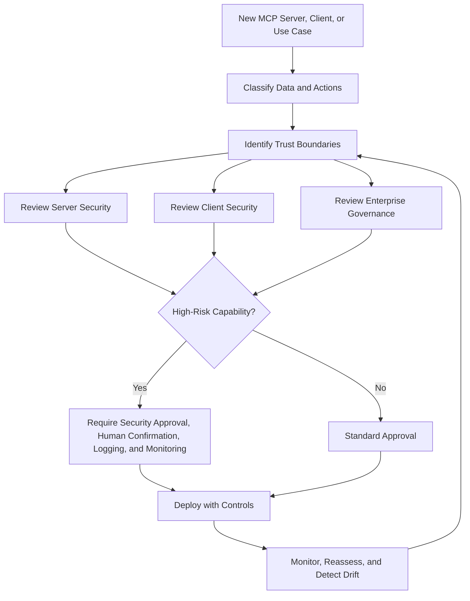

# Appendix C: Security Review

Use this appendix when recording an MCP security review. The working checklists live with the topic they review:

| Review | Where the rows live |
| --- | --- |
| Server design, tools, input, output, auth, secrets, logging, release, runtime isolation | [Secure MCP Development](<04. Secure MCP Development.md>) |
| Client approval, prompts, auto-approval, workspace trust | [3.4 Authorization](<03. MCP Threats and Attack Patterns/3.04-authorization-permission.md#tool-permission-ux>) |
| Client configuration, config paths, local processes | [3.2 Configuration](<03. MCP Threats and Attack Patterns/3.02-configuration-deployment.md#host-configuration-files>) |
| Sampling, elicitation, multi-server isolation | [3.8 Context](<03. MCP Threats and Attack Patterns/3.08-context-memory.md#elicitation>) |
| Host and client baseline | [Chapter 3 hub](<03. MCP Threats and Attack Patterns/3. MCP Threats and Attack Patterns.md#host-and-client-baseline>) |
| Inventory, registry, approval, shadow MCP, and the minimum governance program | [3.14 Enterprise Governance](<03. MCP Threats and Attack Patterns/3.14-enterprise-governance.md#enterprise-governance-controls>) |
| Gateway architecture, policy, trust zones, and emergency block | [3.16 Gateway and Egress](<03. MCP Threats and Attack Patterns/3.16-gateway-egress.md#mcp-gateway-architecture>) |
| Role-based access and approval levels | [3.4 Authorization](<03. MCP Threats and Attack Patterns/3.04-authorization-permission.md#role-based-access-control>) |
| SOC readiness | [3.12 Logging and Detection](<03. MCP Threats and Attack Patterns/3.12-logging-detection.md#soc-and-incident-readiness-review>) |
| Incident triage, containment, evidence, rotation, exposure, and recovery | [3.12 Logging and Detection](<03. MCP Threats and Attack Patterns/3.12-logging-detection.md#during-an-incident>) |
| Red-team rules, safe tests, and the finding template | [Test case format](<03. MCP Threats and Attack Patterns/test-case-format.md#mcp-red-team-checklist>) |

## How to record a review

Recommended status values:

| Status | Meaning |
| --- | --- |
| `Pass` | Control is implemented and evidence exists. |
| `Partial` | Control exists but has gaps or limited coverage. |
| `Fail` | Control is missing or ineffective. |
| `Accepted Risk` | Risk is known and formally accepted by an owner. |
| `N/A` | Control does not apply to this MCP system. |

Recommended evidence fields:

| Field | Example |
| --- | --- |
| Owner | Platform team, AppSec, SOC, MCP server maintainer |
| Evidence | Config, code link, policy rule, log sample, ticket, screenshot, test result |
| Review Date | Date of last validation |
| Risk Notes | Residual risk, exception, compensating control |
| Next Review | Date for re-review |

Where a check matches an OWASP MCP Top 10 category, the Test cases column of the [crosswalk](<05. MCP Security Taxonomy.md#owasp-mcp-top-10-crosswalk>) links draft verification requirements, each with one accept and one reject test vector, and a run of those vectors can be filed as the check's test result.

## MCP security review flow



```text
DISCOVER → APPROVE → LIMIT → LOG → MONITOR → RESPOND → IMPROVE
```

## MCP security scorecard

Use this scorecard for a fast maturity review. Score each area 0, 1, or 2.

| Area | 0 - Missing | 1 - Partial | 2 - Strong |
| --- | --- | --- | --- |
| MCP inventory | No inventory | Partial list | Complete client/server/tool inventory |
| Ownership | No owners | Informal owners | Business + technical + security owners |
| Server approval | No review | Manual ad hoc review | Formal review with evidence |
| Tool least privilege | Broad tools | Some scoped tools | Narrow purpose-specific tools |
| Input validation | None | Basic validation | Strict server-side validation |
| Output filtering | None | Basic redaction | Secret + injection-aware filtering |
| Authentication | None/weak | Partial | Consistent authentication |
| Authorization | None/weak | Tool-level partial | Per-action least privilege |
| Secrets | Hardcoded/local | Some vault use | Scoped, managed, rotated secrets |
| Client prompts | Vague | Some details | Full action, target, args, risk |
| Auto-approval | Broad | Limited | Disabled or tightly governed |
| Workspace trust | None | Manual caution | Enforced trust model |
| Logging | Minimal | Partial logs | Centralized correlated logs |
| Monitoring | None | Generic alerts | MCP-specific detections |
| Incident response | Generic only | Draft MCP process | Tested MCP playbooks |
| Red-team testing | None | Ad hoc | Regular abuse-case testing |

| Total | Interpretation |
| ----: | --- |
| 0–10 | High risk. Do not scale MCP usage yet. |
| 11–20 | Early maturity. Restrict to low-risk use cases. |
| 21–26 | Moderate maturity. Improve monitoring, approvals, and governance. |
| 27–32 | Strong maturity. Continue drift detection and periodic review. |

## MCP security review template

```markdown
# MCP Security Review

## Basic Information
- MCP system name:
- Business owner:
- Technical owner:
- Security reviewer:
- Client / host application:
- MCP server name:
- Server source:
- Server version:
- Environment:
- Data classification:
- Risk rating:

## Purpose
Describe what this MCP system is supposed to do.

## Tools, Resources, and Prompts
| Name | Type | Read/Write/Execute | Sensitive Data? | Requires Approval? | Notes |
|---|---|---|---|---|---|
| | | | | | |

## Credentials and Access
- Service account:
- OAuth scopes:
- Secrets location:
- Environments accessible:
- External destinations:

## Review Results
| Area | Status | Evidence | Notes |
|---|---|---|---|
| Ownership | Pass/Partial/Fail/Accepted Risk/N/A | | |
| Tool scope | Pass/Partial/Fail/Accepted Risk/N/A | | |
| Input validation | Pass/Partial/Fail/Accepted Risk/N/A | | |
| Output filtering | Pass/Partial/Fail/Accepted Risk/N/A | | |
| Authentication | Pass/Partial/Fail/Accepted Risk/N/A | | |
| Authorization | Pass/Partial/Fail/Accepted Risk/N/A | | |
| Secrets management | Pass/Partial/Fail/Accepted Risk/N/A | | |
| Client approval flow | Pass/Partial/Fail/Accepted Risk/N/A | | |
| Logging | Pass/Partial/Fail/Accepted Risk/N/A | | |
| Monitoring | Pass/Partial/Fail/Accepted Risk/N/A | | |
| Dependency scanning | Pass/Partial/Fail/Accepted Risk/N/A | | |
| Incident response | Pass/Partial/Fail/Accepted Risk/N/A | | |

## Decision
Approved / Approved with Conditions / Rejected / Needs More Information

## Conditions
| Condition | Owner | Due Date | Compensating Control |
|---|---|---|---|
| | | | |

## Final Notes

```
